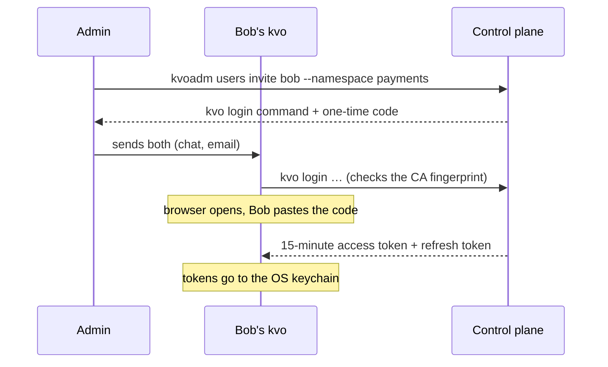

# People and access

You're the cluster admin. This page adds a colleague who works in one namespace and sees nothing
else, then a token for CI.

---

## How sign-in works

The control plane is its own sign-in provider (OpenID Connect). People get in with a **one-time
invite code**, then hold short-lived tokens that refresh themselves:



| | Lives | Where |
|---|---|---|
| Invite code | 15 minutes, used once | Sent to the person |
| Access token | 15 minutes | Memory, sent with each request |
| Refresh token | Rotates on every use | macOS Keychain (or a 0600 file on Linux) |

---

## Invite someone

```bash
bin/kvoadm users invite bob --namespace payments
```

It binds bob as `editor` in `payments` (`--role admin` or `viewer` for others) and prints two things
to send him: the `kvo login …` line and the code.

---

## They sign in

On bob's computer:

```bash
kvo login https://203.0.113.10:6443 --ca sha256:4b1d…
```

His browser opens a "Sign in to Kevaso" page; he pastes the code. The `--ca` fingerprint is how his
`kvo` knows it's talking to *your* cluster: it refuses any other certificate, so no warning to click
through.

```bash
kvo auth whoami
```

```bash
kvo ns payments
```

`kvo ns` sets his default namespace. He can now `apply`, `get`, `exec` in `payments`, and sees no
other namespace.

---

## Roles

Permissions work like Kubernetes RBAC: **Roles** list verbs on resources, **RoleBindings** give a
role to people in a namespace. The built-in roles:

| Role | Can |
|---|---|
| `viewer` | Read silos, service accounts, grants; see that secrets exist, which silos wait for an approval, the [panes]({{ '/panes/' | relative_url }}) silos report, and the [leases]({{ '/networking/leases/' | relative_url }}) on their ports |
| `editor` | Everything `viewer` can, plus create and change silos, `exec`, terminals and files (`silos/ssh`, `silos/files`), moves, opening and closing leased ports, service-account tokens; create and *use* secrets (never read a value back) |
| `admin` | Everything `editor` can, plus roles and bindings in the namespace, exposing silos publicly, reading secret values, answering approvals (a secret's, or a leased port's), deleting panes and leases |
| `cluster-admin` | Everything, everywhere (what `kvoadm init` gives you) |

The permissions beyond plain read and write are their own *subresources*:

| Resource | Verb | Lets you | `viewer` | `editor` | `admin` |
|---|---|---|---|---|---|
| `silos/exec` | `create` | `kvo exec` | | yes | yes |
| `silos/ssh` | `create` | `kvo ssh`, the terminal in `kvo ui` | | yes | yes |
| `silos/files` | `get` | Read and list a silo's files (`kvo cp` out, `kvo ui` browsing) | | yes | yes |
| `silos/files` | `create` | Write files into a silo (`kvo cp` in, `kvo ui` upload) | | yes | yes |
| `silos/move` | `create` | `kvo move` | | yes | yes |
| `panes` | `get`, `list`, `watch` | `kvo get panes`, `kvo pane watch`, `kvo pane bundle` | yes | yes | yes |
| `panes` | `delete` | Clear a pane | | | yes |
| `silos/exposure` | `open` | `kvo open silo`, `kvo close silo`: open and close a silo's [leased ports]({{ '/networking/leases/' | relative_url }}) | | yes | yes |
| `silos/exposure` | `approve` | Answer an `expose` approval (a leased port that needs a yes) | | | yes |
| `leases` | `get`, `list`, `watch` | `kvo get leases` | yes | yes | yes |
| `leases` | `delete` | Delete a lease | | | yes |

`open` and `approve` on `silos/exposure` can be limited to one silo by name, or to silos by label,
like `approve` on secrets. Making a port public at all is still `create` on `services/expose-public`:
a lease only decides when.

[Terminals, files and the small UI]({{ '/silos/terminals/' | relative_url }}) are as strong as `exec`: give them the same care.

**Kinds you define** are named by their resource, `PLURAL.GROUP` (`databases.acme.dev`), with
`PLURAL.GROUP/status` for the status, and `PLURAL.GROUP/scale` (`get`, `update`) for `kvo scale`. No
built-in role has them, only `cluster-admin`; you write a role, as in [Defining your own kind]({{ '/extending/kinds/' | relative_url }}#roles).

Ask the cluster what you may do:

```bash
kvo auth can-i create silos/exec -n payments
```

It exits 0 for yes and 1 for no, so it fits in scripts.

---

**Plugins** are objects too: `plugins` (cluster-scoped) is read by `kvoadm plugin list`. Only
`cluster-admin` has it, and a plugin's own controller can read and report on its own `Plugin`
and nothing else of that kind. A plugin's controller runs as the service account
`kevaso-system/plugin-NAME`, with exactly the roles in its package, never `cluster-admin`
([Plugins]({{ '/extending/plugins/#plugin-operators' | relative_url }})).

---

## Contexts

Like kubeconfig contexts: one per cluster you use.

```bash
kvo ctx
```

```bash
kvo ctx home
```

The file is `~/.kevaso/config.yaml` (or `$KVO_CONFIG`). It holds addresses, CA fingerprints and
certificate paths, never tokens. With [more than one system node]({{ '/operations/ha/' | relative_url }}),
a context's `server` can list them, comma-separated: `kvo` sticks to the last one that answered
and moves on only when it can't connect.

---

## Tokens for CI

A **service account** is an identity for a script or a pipeline:

Save this as `deployer.yaml`:

```yaml
apiVersion: kevaso/v1
kind: ServiceAccount
metadata: { name: deployer, namespace: payments }
```

```bash
kvo apply -f deployer.yaml
```

Give it a role with a RoleBinding (subject kind `ServiceAccount`), then mint a token:

```bash
kvo create token deployer -n payments --duration 1h
```

In CI, set `KVO_TOKEN` to it (and `KVO_CA_FILE` to the cluster CA). Deleting the service account
revokes every token it has.

---

## Removing someone

```bash
bin/kvoadm users disable bob
```

His tokens stop working at once: every request checks that the person is still enabled.

---

## The audit log

Every decision about a person or service account (allowed or refused), every sign-in, every secret
read and every broker call is written to `/var/lib/kevaso/audit.log` on the control plane, one JSON
object per line. See [Operating]({{ '/operations/' | relative_url }}#the-audit-log).
