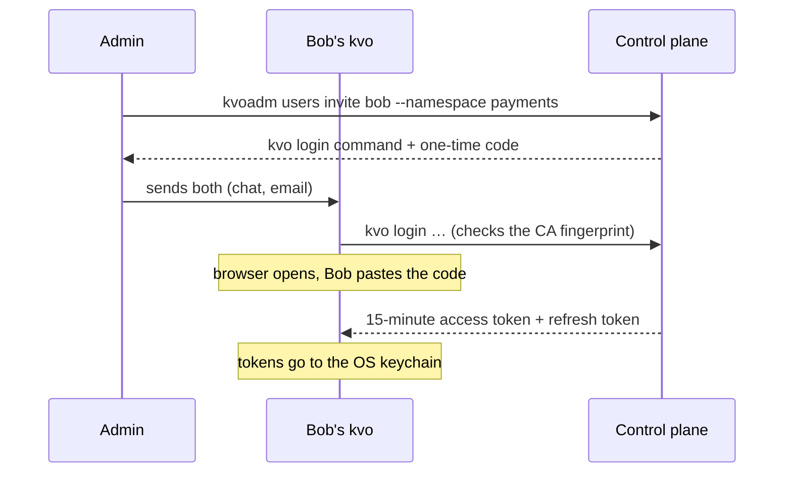

# People and access

You're the cluster admin. This page adds a colleague who works in one namespace and sees nothing
else, then a token for CI.

---

## How sign-in works

The control plane is its own sign-in provider (OpenID Connect). People get in with a **one-time
invite code**, then hold short-lived tokens that refresh themselves:



| | Lives | Where |
|---|---|---|
| Invite code | 15 minutes, used once | Sent to the person |
| Access token | 15 minutes | Memory, sent with each request |
| Refresh token | Rotates on every use. Idle limit 30 days | macOS Keychain (or a 0600 file on Linux) |

A refresh token is used once. Two `kvo` commands that refresh at the same moment can both present the token that was just replaced. Within **60 seconds** that is a race: the session stays, and the answer is `refresh raced with another; try again`. The client reads its token again. After 60 seconds the same token ends the session for everyone: `refresh token was already used; session revoked`. The audit log records `refresh-token-reuse` only then. Sign in again.

---

## Invite someone

```bash
bin/kvoadm users invite bob --namespace payments
```

It binds bob as `editor` in `payments` (`--role admin` or `viewer` for others) and prints two things
to send him: the `kvo login …` line and the code. Only a cluster admin can create an invite. A namespace admin cannot, and giving a role `create`
on `invites` does not change that: an invite can name any person and any groups.

---

## They sign in

On bob's computer:

```bash
kvo login https://203.0.113.10:6443 --ca sha256:4b1d…
```

His browser opens a "Sign in to Kevaso" page; he pastes the code. The `--ca` fingerprint is how his
`kvo` knows it's talking to *your* cluster: it refuses any other certificate, so no warning to click
through.

```bash
kvo auth whoami
```

```bash
kvo ns payments
```

`kvo ns` sets his default namespace. He can now `apply`, `get`, `exec` in `payments`, and sees no
other namespace.

---

## Roles

Permissions work like Kubernetes RBAC: **Roles** list verbs on resources, **RoleBindings** give a
role to people in a namespace. The built-in roles:

| Role | Can |
|---|---|
| `viewer` | Read silos, silo sets, services, VM images, ingresses, certificates, service accounts, grants and OpenShell policies; see that secrets exist, which silos wait for an approval, the [panes]({{ '/panes/' | relative_url }}) silos report, the [leases]({{ '/networking/leases/' | relative_url }}) on their ports, and the [IPs]({{ '/networking/ips/' | relative_url }}) |
| `editor` | Everything `viewer` can, plus create and change those objects, `exec`, terminals and files (`silos/ssh`, `silos/files`), plain moves (`create` on `silos/move`), opening and closing leased ports; create and *use* secrets (never read a value back); *use* an IP an admin made |
| `admin` | Everything `editor` can, plus roles and bindings in the namespace, minting service-account tokens, opening ports on a host address or behind a load balancer (`services/expose-public`), publishing on a public ingress class (`ingresses/publish-public`), creating and releasing IPs, reading secret values, answering approvals (a secret's, or a leased port's), deleting panes, approvals and leases |
| `cluster-admin` | Everything, everywhere (what `kvoadm init` gives you) |

The permissions beyond plain read and write are their own *subresources*:

| Resource | Verb | Lets you | `viewer` | `editor` | `admin` |
|---|---|---|---|---|---|
| `silos/exec` | `create` | `kvo exec` | | yes | yes |
| `silos/ssh` | `create` | `kvo ssh`, the terminal in `kvo ui` | | yes | yes |
| `silos/files` | `get` | Read and list a silo's files (`kvo cp` out, `kvo ui` browsing) | | yes | yes |
| `silos/files` | `create` | Write files into a silo (`kvo cp` in, `kvo ui` upload) | | yes | yes |
| `silos/move` | `create` | `kvo move`, a plain move | | yes | yes |
| `hosts/confirm-off` | `create` | `kvo move --confirm-fenced`, and `--insist` with it: say the old copy is off. Cluster-scoped. A RoleBinding cannot grant it | | | |
| `serviceaccounts/token` | `create` | `kvo create token` | | | yes |
| `panes` | `get`, `list`, `watch` | `kvo get panes`, `kvo pane watch`, `kvo pane bundle` | yes | yes | yes |
| `panes` | `delete` | Clear a pane | | | yes |
| `silos/exposure` | `open` | `kvo open silo`, `kvo close silo`: open and close a silo's [leased ports]({{ '/networking/leases/' | relative_url }}) | | yes | yes |
| `silos/exposure` | `approve` | Answer an `expose` approval (a leased port that needs a yes) | | | yes |
| `leases` | `get`, `list`, `watch` | `kvo get leases` | yes | yes | yes |
| `leases` | `delete` | Delete a lease | | | yes |
| `approvals` | `get`, `list`, `watch` | `kvo get approvals` | yes | yes | yes |
| `approvals` | `delete` | Clear an approval | | | yes |
| `secrets` | `use` | Name a secret in a grant, or as a silo's `container.pull.secretRef` | | yes | yes |
| `secrets` | `read-value` | `kvo get secret --reveal` | | | yes |
| `secrets` | `approve` | `kvo approve`, `kvo deny` | | | yes |
| `ips` | `get`, `list`, `watch` | `kvo get ips`, `kvo describe ip` | yes | yes | yes |
| `ips` | `use` | Name an IP: a silo's `service.loadBalancer.ip` or `network.egress.ip`, a service's `loadBalancerIP` | | yes | yes |
| `ips` | `create`, `update`, `patch`, `delete` | `kvo create ip`, `kvo ip keep`, `kvo ip release` | | | yes |
| `services/expose-public` | `create` | Open a port on a host address (`hostPort`) or behind a load balancer, on a silo, a silo set or a `LoadBalancer` service. Also an edit that widens that reach (below) | | | yes |
| `ingresses/publish-public` | `create` | Publish an `Ingress` on a public class | | | yes |

`cluster-admin` holds `create` on `hosts/confirm-off` (it holds every resource). `editor` and `admin`
do not. A plain move stays `create` on `silos/move`. `--confirm-fenced` and `--insist` are a fact
about a machine, so the check is cluster-scoped: a RoleBinding in the silo's namespace does not
grant it. An editor who sends either flag gets `403 Forbidden`:

```text
saying the old copy is off (--confirm-fenced, and --insist with it) needs create on hosts/confirm-off. That permission is cluster-scoped and only cluster-admin has it by default. editor and admin keep plain moves (create on silos/move)
```

`kvo` prints that sentence as the 403, then prints it again after a blank line.

To give it to someone, write a ClusterRole and a ClusterRoleBinding. `USER` is the name `kvo auth whoami` prints after the type (`user USER`).

Save this as `confirm-off.yaml`:

```yaml
apiVersion: kevaso/v1
kind: ClusterRole
metadata: { name: confirm-off }
rules:
  - verbs: [create]
    resources: [hosts/confirm-off]
---
apiVersion: kevaso/v1
kind: ClusterRoleBinding
metadata: { name: confirm-off }
roleRef: { kind: ClusterRole, name: confirm-off }
subjects:
  - { kind: User, name: USER }
```

```bash
kvo apply -f confirm-off.yaml
```

Only someone who already holds the permission can grant it
([below](#you-cant-give-more-than-you-hold)).

`open` and `approve` on `silos/exposure` can be limited to one silo by name, or to silos by label,
like `approve` on secrets. Opening a port on a host address or behind a load balancer is
`create` on `services/expose-public`. The same permission is required when an edit widens that
reach. Removing or tightening does not need it. A `ClusterIP` service never does. Widening is any of these:

- a new port, or a new network on a port (`internal` or `external` where it was not open);
- a changed protocol, host number, or load-balancer class, or a load balancer set where there was none;
- wider sources: a source removed, a wider one added, or sources cleared (empty, and `0.0.0.0/0`, are the world);
- a lease removed, or a lease that needed a yes made automatic;
- labels, or a selector, that newly match a load balancer, including a service that becomes one and a new port on one;
- an Ingress backend the stored Ingress did not already name, on a port that opens only on a lease.

A lease only decides when. Naming an IP of your own
needs `use` on that IP. Minting a service-account token is `create` on `serviceaccounts/token`.
A token holds whatever its account holds, so `editor` does not have it. In the namespace
`kevaso-system`, only a cluster admin may create, change or delete an object, a token included.

[Terminals, files and the small UI]({{ '/silos/terminals/' | relative_url }}) are as strong as `exec`: give them the same care.

### You can't give more than you hold

Creating or changing a Role, ClusterRole, RoleBinding or ClusterRoleBinding is refused when it would
give a permission its author doesn't have, where the grant lands: in the namespace for a Role and a
RoleBinding, everywhere for a ClusterRole and a ClusterRoleBinding. It prevents a person with `admin`
in one namespace from making themselves, or anyone, more than that.

- Every verb on every resource is compared on its own. A wildcard (`*`) needs the same wildcard held.
  A permission held only for one named silo or for silos with a label never covers a wider one.
- A binding is judged by the rules of the role it names. A binding to a role that doesn't exist is
  refused too, because a role made later would silently reach its subjects, unless you hold `*` on
  `*`.
- A change that leaves the rules (or the role and subjects of a binding) as they are passes, so a
  label can still change.
- `cluster-admin` holds everything, so it can give anything. There is no `bind` verb: nobody can hand
  out what they don't hold.

The refusal is `403 Forbidden`, and names what is missing (the first six, then `and more`):

```text
Role deployer would grant permissions you don't hold in namespace payments: get hosts; update silos/status
```

For a binding: `RoleBinding ops (ClusterRole cluster-admin) would grant permissions you don't hold in
namespace payments: …`, or `RoleBinding ops: Role deployer doesn't exist, and a binding to a role
made later could grant anything: create the role first`. So a namespace `admin` can write roles and
bindings in its namespace, but only with permissions its own role has.

**Kinds you define** are named by their resource, `PLURAL.GROUP` (`databases.acme.dev`), with
`PLURAL.GROUP/status` for the status, and `PLURAL.GROUP/scale` (`get`, `update`) for `kvo scale`. No
built-in role has them, only `cluster-admin`; you write a role, as in [Defining your own kind]({{ '/extending/kinds/' | relative_url }}#roles).

Ask the cluster what you may do:

```bash
kvo auth can-i create silos/exec -n payments
```

It exits 0 for yes and 1 for no, so it fits in scripts.

---

**Plugins** are objects too: `plugins` (cluster-scoped) is read by `kvoadm plugin list`. Only
`cluster-admin` has it, and a plugin's own controller can read and report on its own `Plugin`
and nothing else of that kind. A plugin's controller runs as the service account
`kevaso-system/plugin-NAME`, with exactly the roles in its package, never `cluster-admin`
([Plugins]({{ '/extending/plugins/#plugin-operators' | relative_url }})).

The namespace `kevaso-system` is reserved for cluster admins. Only a cluster admin may create,
change or delete an object in it, whatever a role or binding says. Reading still follows the role.

A cluster secret has no namespace. Creating, changing and deleting one is for a cluster admin, and
no role can grant that. A plugin reads one value only when a ClusterRole grants `get` on
`clustersecrets/value` and names that secret, bound to the service account of the side that
uses it in `kevaso-system`: `plugin-NAME` for the controller side, `plugin-NAME-node` for the node
side. A worker only ever reads for the node side. A rule with no names grants none. See
[Plugins]({{ '/extending/plugins/#install-a-provider-plugin' | relative_url }}).

---

## Contexts

Like kubeconfig contexts: one per cluster you use.

```bash
kvo ctx
```

```bash
kvo ctx home
```

The file is `~/.kevaso/config.yaml` (or `$KVO_CONFIG`). It holds addresses, CA fingerprints and
certificate paths, never tokens. With [more than one system node]({{ '/operations/ha/' | relative_url }}),
a context's `server` can list them, comma-separated: `kvo` sticks to the last one that answered
and moves on only when it can't connect.

The certificate `kvoadm init` writes lasts 30 days. `kvo` renews it by itself at two thirds of that
life, or inside the last ten days if that comes sooner, and stores the new certificate as the same
person. You do nothing while it can still connect.

Once it has expired, `kvo` stops:

```text
context home certificate for ops expired on 2026-12-18T15:04:05Z. On a control-plane host, run: kevasod admin sign-user --name ops
```

That command reads a certificate request on stdin and prints JSON with `certificate` and `ca`. It
does not write the context. Run `kvoadm init` again against the same machine, with the same
`--name` and `--cluster`:

```bash
bin/kvoadm init root@203.0.113.10 \
    --ssh-key ~/.ssh/kevaso_ed25519 \
    --host-key SHA256:kVvp5Yv9fNU4r4yX2P7+O99SU45jwdxC60ylimGFta4 \
    --kevasod bin/kevasod-linux-amd64 \
    --name hv1 \
    --cluster home
```

It keeps the installed unit (see
[Running init again]({{ '/setup/single-node/#running-init-again' | relative_url }})), makes a new
key on your computer, and writes a new context.

Inside the last ten days, a renewal that fails is a warning and the current certificate is still
used. The warning names the same command.

---

## Tokens for CI

A **service account** is an identity for a script or a pipeline:

Save this as `deployer.yaml`:

```yaml
apiVersion: kevaso/v1
kind: ServiceAccount
metadata: { name: deployer, namespace: payments }
```

```bash
kvo apply -f deployer.yaml
```

Give it a role with a RoleBinding (subject kind `ServiceAccount`), then mint a token:

```bash
kvo create token deployer -n payments --duration 1h
```

In CI, set `KVO_TOKEN` to it (and `KVO_CA_FILE` to the cluster CA). A namespace `admin` can mint
the token. An `editor` cannot. In `kevaso-system`, only a cluster admin can. Deleting the service
account revokes every token it has.

---

## Removing someone

```bash
bin/kvoadm users disable bob
```

His tokens stop working at once: every request checks that the person is still enabled.

---

## The audit log

Every decision about a person or service account (allowed or refused), every sign-in, every secret
read and every broker call is written to `/var/lib/kevaso/audit.log` on the control plane, one JSON
object per line. See [Operating]({{ '/operations/' | relative_url }}#the-audit-log).
