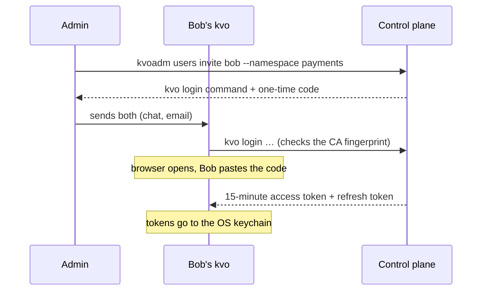

# People and access

You're the cluster admin. This page adds a colleague who works in one namespace and sees nothing
else, gives out roles, and makes a token for CI. What the colleague does with the invite (signing
in, contexts, asking what they may do) is on [Signing in and contexts]({{ '/use/sign-in/' | relative_url }}).

---

## How sign-in works

The control plane is its own sign-in provider (OpenID Connect). People get in with a **one-time
invite code**, then hold short-lived tokens that refresh themselves:



---

How long each token lives, and what happens when two commands refresh at once, is on
[Signing in and contexts]({{ '/use/sign-in/#how-sign-in-works' | relative_url }}).

---

## Invite someone

```bash
bin/kvoadm users invite bob --namespace payments
```

It binds bob as `editor` in `payments` (`--role admin` or `viewer` for others) and prints two things
to send him: the `kvo login …` line and the code. Only a cluster admin can create an invite. A namespace admin cannot, and giving a role `create`
on `invites` does not change that: an invite can name any person and any groups.

He signs in with what you sent: [Signing in and contexts]({{ '/use/sign-in/#sign-in' | relative_url }}).

---

## Roles

Permissions work like Kubernetes RBAC: **Roles** list verbs on resources, **RoleBindings** give a
role to people in a namespace. The built-in roles:

| Role | Can |
|---|---|
| `viewer` | Read silos, silo sets, services, VM images, ingresses, certificates, service accounts, grants and OpenShell policies; see that secrets exist, which silos wait for an approval, the [panes]({{ '/use/panes/' | relative_url }}) silos report, the [leases]({{ '/use/networking/leases/' | relative_url }}) on their ports, and the [IPs]({{ '/admin/ips/' | relative_url }}) |
| `editor` | Everything `viewer` can, plus create and change those objects, `exec`, terminals and files (`silos/ssh`, `silos/files`), plain moves (`create` on `silos/move`), opening and closing leased ports; create and *use* secrets (never read a value back); *use* an IP an admin made |
| `admin` | Everything `editor` can, plus roles and bindings in the namespace, minting service-account tokens, opening ports on a host address or behind a load balancer (`services/expose-public`), publishing on a public ingress class (`ingresses/publish-public`), creating and releasing IPs, reading secret values, answering approvals (a secret's, or a leased port's), deleting panes, approvals and leases |
| `cluster-admin` | Everything, everywhere (what `kvoadm init` gives you) |

The permissions beyond plain read and write are their own *subresources*:

| Resource | Verb | Lets you | `viewer` | `editor` | `admin` |
|---|---|---|---|---|---|
| `silos/exec` | `create` | `kvo exec` | | yes | yes |
| `silos/ssh` | `create` | `kvo ssh`, the terminal in `kvo ui` | | yes | yes |
| `silos/files` | `get` | Read and list a silo's files (`kvo cp` out, `kvo ui` browsing) | | yes | yes |
| `silos/files` | `create` | Write files into a silo (`kvo cp` in, `kvo ui` upload) | | yes | yes |
| `silos/move` | `create` | `kvo move`, a plain move | | yes | yes |
| `hosts/confirm-off` | `create` | `kvo move --confirm-fenced`, and `--insist` with it (cluster-admin only by default: `kvoadm kvo move …`): say the old copy is off. Cluster-scoped. A RoleBinding cannot grant it | | | |
| `serviceaccounts/token` | `create` | `kvo create token` | | | yes |
| `panes` | `get`, `list`, `watch` | `kvo get panes`, `kvo pane watch`, `kvo pane bundle` | yes | yes | yes |
| `panes` | `delete` | Clear a pane | | | yes |
| `silos/exposure` | `open` | `kvo open silo`, `kvo close silo`: open and close a silo's [leased ports]({{ '/use/networking/leases/' | relative_url }}) | | yes | yes |
| `silos/exposure` | `approve` | Answer an `expose` approval (a leased port that needs a yes) | | | yes |
| `leases` | `get`, `list`, `watch` | `kvo get leases` | yes | yes | yes |
| `leases` | `delete` | Delete a lease | | | yes |
| `approvals` | `get`, `list`, `watch` | `kvo get approvals` | yes | yes | yes |
| `approvals` | `delete` | Clear an approval | | | yes |
| `secrets` | `use` | Name a secret in a grant, or as a silo's `container.pull.secretRef` | | yes | yes |
| `secrets` | `read-value` | `kvo get secret --reveal` | | | yes |
| `secrets` | `approve` | `kvo approve`, `kvo deny` | | | yes |
| `ips` | `get`, `list`, `watch` | `kvo get ips`, `kvo describe ip` | yes | yes | yes |
| `ips` | `use` | Name an IP: a silo's `service.loadBalancer.ip` or `network.egress.ip`, a service's `loadBalancerIP` | | yes | yes |
| `ips` | `create`, `update`, `patch`, `delete` | `kvo create ip`, `kvo ip keep`, `kvo ip release` | | | yes |
| `services/expose-public` | `create` | Open a port on a host address (`hostPort`) or behind a load balancer, on a silo, a silo set or a `LoadBalancer` service. Also an edit that widens that reach (below) | | | yes |
| `ingresses/publish-public` | `create` | Publish an `Ingress` on a public class | | | yes |

`cluster-admin` holds `create` on `hosts/confirm-off` (it holds every resource). `editor` and `admin`
do not. A plain move stays `create` on `silos/move`. `--confirm-fenced` and `--insist` are a fact
about a machine, so the check is cluster-scoped: a RoleBinding in the silo's namespace does not
grant it. An editor who sends either flag gets `403 Forbidden`:

```text
saying the old copy is off (--confirm-fenced, and --insist with it) needs create on hosts/confirm-off. That permission is cluster-scoped and only cluster-admin has it by default. editor and admin keep plain moves (create on silos/move)
```

`kvo` prints that sentence as the 403, then prints it again after a blank line.

To give it to someone, write a ClusterRole and a ClusterRoleBinding. `USER` is the name `kvo auth whoami` prints after the type (`user USER`).

Save this as `confirm-off.yaml`:

```yaml
apiVersion: kevaso/v1
kind: ClusterRole
metadata: { name: confirm-off }
rules:
  - verbs: [create]
    resources: [hosts/confirm-off]
---
apiVersion: kevaso/v1
kind: ClusterRoleBinding
metadata: { name: confirm-off }
roleRef: { kind: ClusterRole, name: confirm-off }
subjects:
  - { kind: User, name: USER }
```

```bash
kvoadm kvo apply -f confirm-off.yaml
```

Only someone who already holds the permission can grant it
([below](#you-cant-give-more-than-you-hold)).

`open` and `approve` on `silos/exposure` can be limited to one silo by name, or to silos by label,
like `approve` on secrets. Opening a port on a host address or behind a load balancer is
`create` on `services/expose-public`. The same permission is required when an edit widens that
reach. Removing or tightening does not need it. A `ClusterIP` service never does. Widening is any of these:

- a new port, or a new network on a port (`internal` or `external` where it was not open);
- a changed protocol, host number, or load-balancer class, or a load balancer set where there was none;
- wider sources: a source removed, a wider one added, or sources cleared (empty, and `0.0.0.0/0`, are the world);
- a lease removed, or a lease that needed a yes made automatic;
- labels, or a selector, that newly match a load balancer, including a service that becomes one and a new port on one;
- an Ingress backend the stored Ingress did not already name, on a port that opens only on a lease;
- a SiloSet's template labels, a selector on the set's label, or a silo's labels, that newly bring silos behind a load balancer, or behind a Service that an Ingress already names onto a leased port.

A lease only decides when. Naming an IP of your own
needs `use` on that IP. Minting a service-account token is `create` on `serviceaccounts/token`.
A token holds whatever its account holds, so `editor` does not have it. In the namespace
`kevaso-system`, only a cluster admin may create, change or delete an object, a token included.

[Terminals, files and the small UI]({{ '/use/silos/terminals/' | relative_url }}) are as strong as `exec`: give them the same care.

### You can't give more than you hold

Creating or changing a Role, ClusterRole, RoleBinding or ClusterRoleBinding is refused when it would
give a permission its author doesn't have, where the grant lands: in the namespace for a Role and a
RoleBinding, everywhere for a ClusterRole and a ClusterRoleBinding. It prevents a person with `admin`
in one namespace from making themselves, or anyone, more than that.

- Every verb on every resource is compared on its own. A wildcard (`*`) needs the same wildcard held.
  A permission held only for one named silo or for silos with a label never covers a wider one.
- A binding is judged by the rules of the role it names. A binding to a role that doesn't exist is
  refused too, because a role made later would silently reach its subjects, unless you hold `*` on
  `*`.
- A change that leaves the rules (or the role and subjects of a binding) as they are passes, so a
  label can still change.
- `cluster-admin` holds everything, so it can give anything. There is no `bind` verb: nobody can hand
  out what they don't hold.

The refusal is `403 Forbidden`, and names what is missing (the first six, then `and more`):

```text
Role deployer would grant permissions you don't hold in namespace payments: get hosts; update silos/status
```

For a binding: `RoleBinding ops (ClusterRole cluster-admin) would grant permissions you don't hold in
namespace payments: …`, or `RoleBinding ops: Role deployer doesn't exist, and a binding to a role
made later could grant anything: create the role first`. So a namespace `admin` can write roles and
bindings in its namespace, but only with permissions its own role has.

**Kinds you define** are named by their resource, `PLURAL.GROUP` (`databases.acme.dev`), with
`PLURAL.GROUP/status` for the status, and `PLURAL.GROUP/scale` (`get`, `update`) for `kvo scale`. No
built-in role has them, only `cluster-admin`; you write a role, as in [Defining your own kind]({{ '/admin/extending/kinds/' | relative_url }}#roles).

Ask the cluster what you may do:

```bash
kvo auth can-i create silos/exec -n payments
```

It exits 0 for yes and 1 for no, so it fits in scripts. `ssh`, `files`, `open`, `close` and `move`
are read as silo subresources, so `silos/ssh` is the terminal on a silo and not a silo named `ssh`.

---

**Plugins** are objects too: `plugins` (cluster-scoped) is read by `kvoadm plugin list`. Only
`cluster-admin` has it, and a plugin's own controller can read and report on its own `Plugin`
and nothing else of that kind. A plugin's controller runs as the service account
`kevaso-system/plugin-NAME`, with exactly the roles in its package, never `cluster-admin`
([Plugins]({{ '/admin/extending/plugins/#plugin-operators' | relative_url }})).

The namespace `kevaso-system` is reserved for cluster admins. Only a cluster admin may create,
change or delete an object in it, whatever a role or binding says. Reading still follows the role.

A binding for the group `system:serviceaccounts:NS` counts as naming namespace NS. That namespace
cannot be deleted while the binding exists.

A cluster secret has no namespace. Creating, changing and deleting one is for a cluster admin, and
no role can grant that. A plugin reads one value only when a ClusterRole grants `get` on
`clustersecrets/value` and names that secret, bound to the service account of the side that
uses it in `kevaso-system`: `plugin-NAME` for the controller side, `plugin-NAME-node` for the node
side. A worker only ever reads for the node side. A rule with no names grants none. See
[Plugins]({{ '/admin/extending/plugins/#install-a-provider-plugin' | relative_url }}).

---

## Your own kvo, and the admin certificate

`kvoadm init` writes your `kvo` context as a **plain user**: `editor` in every namespace (namespace
`default` is made for you to start in), nothing cluster-wide. Namespaces, hosts, cluster secrets
and roles are an admin's, and the admin certificate is never in `kvo`'s file: it stays in
`kvoadm`'s [cluster folder](#kvoadms-cluster-folder). Run `kvo` as the admin through `kvoadm`:

```bash
kvoadm kvo create namespace shop
```

Everything after `kvoadm kvo` is a `kvo` command, run with the admin certificate. Where a user page
says an admin does a step first, this is how.

The certificate `kvoadm init` writes lasts 30 days, and `kvo` renews it by itself
([Signing in and contexts]({{ '/use/sign-in/#a-certificate-context' | relative_url }})). Once it has
expired, `kvo` stops and names the recovery:

```text
context NAME certificate for USER expired on DATE. Run: kvoadm users resign root@HOST --name USER --kvo
```

```bash
kvoadm users resign root@HOST --name USER --kvo
```

Without `--kvo`, the same command re-signs the admin certificate in the cluster folder.

That command signs a new client certificate over SSH and writes it into the context. The key is
made on your computer. The control plane only sees the request. Use it when the certificate has
expired, or when a renewal inside the last ten days fails.

---

## Tokens for CI

A **service account** is an identity for a script or a pipeline:

Save this as `deployer.yaml`:

```yaml
apiVersion: kevaso/v1
kind: ServiceAccount
metadata: { name: deployer, namespace: payments }
```

```bash
kvoadm kvo apply -f deployer.yaml
```

Give it a role with a RoleBinding (subject kind `ServiceAccount`), then mint a token:

```bash
kvoadm kvo create token deployer -n payments --duration 1h
```

A namespace `admin` (someone you invited with `--role admin`) runs the same commands with their own
`kvo`, without `kvoadm`.

In CI, set `KVO_TOKEN` to it (and `KVO_CA_FILE` to the cluster CA). A namespace `admin` can mint
the token. An `editor` cannot. In `kevaso-system`, only a cluster admin can. Deleting the service
account revokes every token it has.

---

## Removing someone

```bash
bin/kvoadm users disable bob
```

His tokens stop working at once: every request checks that the person is still enabled.

---

## The audit log

Every decision about a person or service account (allowed or refused), every sign-in, every secret
read and every broker call is written to `/var/lib/kevaso/audit.log` on the control plane, one JSON
object per line. See [Operating]({{ '/admin/operations/' | relative_url }}#the-audit-log).

---

## kvoadm's cluster folder

`kvoadm` never reads `kvo`'s file. Each cluster it manages is a folder,
`~/.kevaso/clusters/CLUSTER/` (`$KVOADM_HOME` replaces `~/.kevaso`), with two files:

| File | Whose | Holds |
|---|---|---|
| `cluster.yaml` | The team's: commit it to a repository you share | The cluster's name, API addresses and CA certificate; every host by name with its SSH addresses, in the order to try; the admins and their SSH public keys. Never a secret: `kvoadm` refuses one that holds a private key, a token or a credential path |
| `local.yaml` | This computer's: never committed | Which admin you are, the path to your SSH private key, your admin certificate (`admin.crt` and `admin.key` beside it), the host keys you pinned, and addresses only you use |

The folder's `.gitignore` keeps everything but `cluster.yaml` out of a repository, including
`local.yaml`, your credential and the keys hosts pin (`signing.key`, `ssh/`).

`kvoadm init` makes the folder, and lists you as the first admin. Every other command picks the
cluster with `--cluster NAME`, else `$KVOADM_CLUSTER`, else the only folder there is.

### A host's addresses

A host can have several addresses: one on the LAN, one on a VPN, one from outside. `kvoadm` tries
them in order (your own first, then the team's, then the address the host was added with) and uses
the first that answers **with the host key pinned for that host**. One where another machine
answers is skipped. A host's name works wherever an address did:

```bash
kvoadm host ssh home1 add root@home1.example.ts.net
```

```bash
kvoadm host ssh home1 add root@192.168.1.50 --local
```

```bash
kvoadm host ssh home1
```

```bash
kvoadm reset home1
```

Without `--local` an address goes in `cluster.yaml`, for everyone. With it, it goes in your
`local.yaml`, tried before the shared ones.

### Admins

The admins' public keys in `cluster.yaml` are what every host lets in. Adding an admin is a commit
and a sync:

```bash
kvoadm admins add ana ana.pub
```

```bash
kvoadm admins sync
```

`sync` writes a block it owns into `authorized_keys` of the user `kvoadm` logs in as on each host,
and leaves every other line alone. It refuses a change that would lock out the key it is connected
with. `init` and `host add` put the block on each new host. `kvoadm admins remove NAME`, then a
sync, takes someone's keys off every host.

A teammate who clones the repository has `cluster.yaml` and no credential: `kvoadm` knows the
hosts and says so. An admin certificate for them comes from `kvoadm users resign HOST --name THEM`,
run over SSH as one of the admins.
