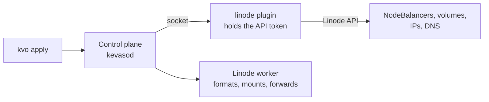

# Linode

The Linode provider lets silos on your Linode workers use what Linode offers:

| You write | You get |
|---|---|
| `type: LoadBalancer` with `loadBalancer: { provider: linode }` on a service | A NodeBalancer with its own IP, in front of the silo |
| An [`IP`]({{ '/use/networking/ips/' | relative_url }}) of `type: Provider`, `provider: linode`, named by a `HostPort` service | An IPv4 you keep, that follows the silo from one Linode to another in its region |
| `volumes: [{ class: linode-block, … }]` | A Block Storage volume, kept when the silo restarts, deleted with it |
| `dns: { provider: linode }` on an IngressClass | Its host names published in Linode DNS |

It only narrows *where* those silos go: onto your Linodes, in the region their volume is in. The
rest of the cluster (a box at home, another provider) is unchanged.



Linode machines have no KVM, so their silos use a container runtime (`docker` or `podman`).

---

## Before you start

- A cluster with Linode workers added with `--runtime docker` ([Adding workers]({{ '/admin/workers/' | relative_url }})).
- Each Linode worker has a **private IPv4** (Cloud Manager → the Linode → Network → Add an IP address
  → Private, then reboot it). NodeBalancers reach workers over it. Add the worker with its public
  address as `--external-ip`: the provider then makes the Linode's private address its internal IP
  (see [Addresses, ports and names]({{ '/use/networking/model/' | relative_url }})).
- A Linode **API token** (Cloud Manager → your profile → API Tokens → Create a Personal Access Token)
  with read/write on *Linodes*, *IPs* and *Volumes*, plus *NodeBalancers* and *Domains* if you use
  them. Without one of these, what needs it fails with Linode's `401`, shown on the silo or Ingress. Save it in a file
  only you can read:

```bash
chmod 600 ~/linode-token.txt
```

---

## Install it

Build the plugin (it runs on the Linodes, so it's built for Linux):

```bash
git clone https://github.com/dlebee/kevaso-provider-linode
```

```bash
make -C kevaso-provider-linode build
```

Store the token as a cluster secret. The binding below names service account `plugin-linode` in the namespace `kevaso-system`, the controller side's account. A host fetches the token only when that account may read it, so it reaches the control plane and never a worker: the node side's account, `plugin-linode-node`, is not bound to it.

Save the token in a file only you can read, in the folder you run `kvo` from:

```bash
chmod 600 linode-token.txt
```

The plugin reads the key `token` of the cluster secret `linode`:

```bash
kvo create clustersecret linode --from-file token=linode-token.txt
```

Save this as `linode-secrets.yaml`. `resourceNames` lists exactly this secret.

```yaml
apiVersion: kevaso/v1
kind: ClusterRole
metadata: { name: linode-secrets }
rules:
  - verbs: [get]
    resources: [clustersecrets/value]
    resourceNames: [linode]
---
apiVersion: kevaso/v1
kind: ClusterRoleBinding
metadata: { name: linode-secrets }
roleRef: { kind: ClusterRole, name: linode-secrets }
subjects:
  - { kind: ServiceAccount, name: plugin-linode, namespace: kevaso-system }
```

```bash
kvo apply -f linode-secrets.yaml
```

On the control plane:

```bash
bin/kvoadm plugin install root@203.0.113.10 \
    --name linode \
    --binary kevaso-provider-linode/bin/kevaso-provider-linode-linux-amd64 \
    --cluster-secret linode
```

```text
→ plugin linode, controller side:
    runs as its own dynamic user
    no capabilities
→ bind a ClusterRole to service account plugin-linode in namespace kevaso-system
→ connected to 203.0.113.10:22 (host key SHA256:kVvp5Yv9…)
→ kevaso-plugin-linode installed (signature verified on the host)
→ cluster secrets linode recorded (kevasod writes each value, root only; the plugin reads it through systemd)
→ plugin linode recorded; kevasod writes its cluster secrets and starts kevaso-plugin-linode.service
```

Install creates the service account `plugin-linode` in the namespace `kevaso-system` and prints the account to bind. It records the name. It does not copy the file. The control plane fetches the token and keeps a copy only root can read. The plugin reads the key as `linode_token` from its credential directory (another cluster secret or key: `tokenSecret` in its config, `{ "name": …, "key": … }`). The value is never on a command line. Workers are not given the name, so they never receive the token. See [Plugins]({{ '/admin/extending/plugins/' | relative_url }}).

To replace the token:

```bash
kvo set clustersecret linode --from-file token=linode-token.txt
```

The control plane writes the new copy and restarts the plugin. The same bytes again leave the plugin running.

Within a few seconds the Linode workers are recognised:

```bash
bin/kvoadm kvo describe host hv2
```

```text
Internal IP:  192.168.129.74 (the provider's private address)
External IP:  172.105.99.247
Region:       ca-central
Provider:     linode (#110903030 in ca-central, private 192.168.129.74)
…
```

---

## A NodeBalancer in front

```yaml
apiVersion: kevaso/v1
kind: Silo
metadata: { name: web, namespace: shop }
spec:
  runtime: docker
  container: { image: docker.io/library/nginx:1.27-alpine }
  resources: { cpu: 1, memory: 256Mi }
  ports:
    - { name: http, port: 80 }
  services:
    - type: LoadBalancer
      loadBalancer: { provider: linode }
      ports: [{ port: http }]
```

```bash
bin/kvo describe silo web -n shop
```

```text
Load balancer:  linode at 172.233.12.40
Node ports:     http 80 → host port 30000 (from 192.168.255.0/24)
```

The NodeBalancer sends each port to the silo's worker on a **node port** over the private network.
The worker forwards that port only from the NodeBalancer's addresses, so it isn't open to the
internet. The silo runs on your Linodes in the NodeBalancer's region; if it is recreated on another
of them, the NodeBalancer follows it and keeps its IP.

**One NodeBalancer per service**, made with the service and deleted with it. Services that should
share one name it with an annotation, and it is deleted with the last of them:

```yaml
services:
  - type: LoadBalancer
    loadBalancer: { provider: linode }
    annotations:
      linode.kevaso.com/nodebalancer: edge     # every service naming edge shares one NodeBalancer
    ports: [{ port: http }]
```

| Annotation | Values | Means |
|---|---|---|
| `linode.kevaso.com/nodebalancer` | A name: lower-case letters, digits and `-`, up to 19 | Services in the namespace naming the same one share one NodeBalancer, each on its own ports. Default: one per service |
| `linode.kevaso.com/nodebalancer-type` | `common` (default), `premium` | Its plan. Fixed when it is made |
| `linode.kevaso.com/algorithm` | `roundrobin` (default), `leastconn`, `source` | How a port picks a backend |
| `linode.kevaso.com/proxy-protocol` | `none` (default), `v1`, `v2` | Sends the client's address with the PROXY protocol: the only way the silo sees it behind a NodeBalancer. The silo must speak it on that port |
| `linode.kevaso.com/client-conn-throttle` | `0` to `20` | New connections per second per client address. `0`: no limit |
| `linode.kevaso.com/check` | `connection` (default), `none` | The backends' health check |
| `linode.kevaso.com/check-interval` | `2` to `3600` | Seconds between checks |
| `linode.kevaso.com/check-timeout` | `1` to `30` | Seconds a check waits |
| `linode.kevaso.com/check-attempts` | `1` to `30` | Failed checks before a backend is taken out |

Other annotations in that domain, and other values, are refused when you apply. A second account
installed as `linode-work` reads `linode-work.kevaso.com/…` instead.

- Two services on one port of a shared NodeBalancer, or disagreeing on its region or type, are a
  conflict: the second waits, and says so.
- NodeBalancers here forward **TCP**. For UDP, use a `HostPort` service on a kept IP
  ([below](#an-ip-that-follows-the-silo)).
- A NodeBalancer can't limit clients by address, so a port with `sources` is left out of it: see
  [balancers and sources]({{ '/use/networking/leases/' | relative_url }}#balancers-and-sources).
- A NodeBalancer has its own IP: `loadBalancer: { ip: NAME }` is refused on Linode.
- **Outgoing traffic can't leave from the NodeBalancer's address.** It belongs to no Linode, so the
  silo sends from its worker's IP, or from an IP it keeps with `egress.source`. See
  [which address its traffic leaves from]({{ '/use/networking/' | relative_url }}#which-address-its-traffic-leaves-from).

A standalone Service can have one too (`type: LoadBalancer`, `loadBalancer: { provider: linode }`):
one NodeBalancer whose backends are every Linode with one of its endpoints, on the Service's node
ports (32000 and up). See [Sets, images and updates]({{ '/use/silos/sets/#an-outside-address' | relative_url }}).

---

## A volume

```yaml
spec:
  runtime: docker
  volumes:
    - { name: data, class: linode-block, size: 20Gi, mountPath: /var/lib/postgresql/data }
```

Kevaso creates the volume in the worker's region, attaches it, formats it **once** (only if it's
empty), and mounts it into the silo. From then on the silo stays in that region: the volume can't
leave it.

```text
Volumes:
  NAME  CLASS         SIZE  MOUNT                      WHERE              STATE
  data  linode-block  20Gi  /var/lib/postgresql/data   ca-central #19072311  mounted on hv2
```

Volumes are 10 GiB at least (Linode's minimum). **Deleting the silo deletes the volume**: Kevaso
waits for the host to unmount it, detaches it, then deletes it. A detach sometimes takes minutes on
Linode. Kevaso keeps asking and shows `detaching from hv2` meanwhile.

---

## An IP that follows the silo

A NodeBalancer's IP belongs to the NodeBalancer. An [IP of type `Provider`]({{ '/use/networking/ips/' | relative_url }})
is an IPv4 Linode reserves for you and shares with the region's Linode workers (in regions where
Linode offers IP sharing with BGP failover). Whichever worker has
the silo announces it (over BGP, like Linode's lelastic), so when the silo moves within the region,
the address moves with it. One silo holds it at a time, and it stays when the silo goes.

```bash
kvo create ip edge -n shop --type Provider --provider linode --region ca-central
```

Then a `HostPort` service names it:

```yaml
spec:
  availability: { onHostLoss: Recreate }
  ports:
    - { name: web, port: 8080 }
  services:
    - type: HostPort
      hostPort: { ip: edge }
      ports: [{ port: web }]
  network:
    egress: { source: { ip: edge } }     # and out from the same address
```

- The silo runs on your Linodes in `ca-central` only, and `kvo describe silo` says so under
  `Can move`. A move to a worker elsewhere is refused, naming the IP.
- After a move, the new worker announces the address. It answers there once Linode has moved it:
  about a minute.
- **Outgoing traffic can leave from it too**, with `egress.source: { ip: edge }`: the silo's
  connections go out from the address people reach it on.
- For a SiloSet, a `Dynamic` [IP set]({{ '/use/networking/ips/#ip-sets' | relative_url }}) with
  `provider: linode` reserves one for each instance as it needs it.

When the worker running it goes down, nothing moves by itself: once you know the Linode is off, `kvo move
silo NAME --to HOST --confirm-fenced --recreate` starts the silo on another worker and the address
answers from there ([When the control plane is lost]({{ '/admin/control-plane-loss/' | relative_url }})).
Add `onControlPlaneLoss: Stop` to the silo and Kevaso restarts it on another worker by itself only
after the old host reports that its copy stopped. A host that is down can't report, so then a person
moves the silo with `kvo move silo NAME -n NS --to HOST --confirm-fenced --recreate`.

The workers announce it with the plugin's node side. Install it on each Linode worker, giving its
region:

```bash
echo '{"region": "ca-central"}' > linode-node.json
```

```bash
bin/kvoadm plugin install root@172.105.99.247 \
    --name linode --side node \
    --binary kevaso-provider-linode/bin/kevaso-provider-linode-linux-amd64 \
    --config linode-node.json
```

The node side has no token and no privileges.

---

## A second account

Install the plugin again under another name, with that account's token in its own cluster secret.
Everything above then names that install: `provider: linode-work`, and annotations in
`linode-work.kevaso.com/`. See [Providers]({{ '/admin/addresses/#providers' | relative_url }}).

---

## DNS for your Ingresses

Add your domain in Cloud Manager (Domains), with Linode's name servers at your registrar. Then give
the IngressClass a DNS provider:

```yaml
apiVersion: kevaso/v1
kind: IngressClass
metadata: { name: public }
spec:
  controller: { driver: nginx, silo: ingress-public, namespace: kevaso-system }
  public: true
  hosts:
    - { host: "*.example.com", namespaces: [payments] }
  dns: { provider: linode }
```

Every host name of its Ingresses gets an A record pointing at the controller's address (its load
balancer's, else its host's external IP), and loses it when the Ingress goes. `ttl` sets the record's
time to live in seconds (300). Each record set carries a `_kevaso-owner` TXT record next to it. Kevaso
never changes a record it didn't create.

The same provider answers DNS-01 challenges, for wildcard certificates:

```yaml
apiVersion: kevaso/v1
kind: Issuer
metadata: { name: letsencrypt }
spec:
  acme:
    server: https://acme-v02.api.letsencrypt.org/directory
    email: you@example.com
    solvers:
      - dns01: { provider: linode, propagationSeconds: 120 }
```

---

## Other storage

A silo can mix classes, and the narrowest one decides where it can go. The classes are listed on
[JuiceFS]({{ '/admin/providers/juicefs/#storage-classes' | relative_url }}).

---

## Removing it

```bash
bin/kvoadm plugin remove root@203.0.113.10 --name linode
```

This removes the unit on that host, and the program, the copy of the token and the service account once no side is left there. The cluster secret and the role stay until you delete them:

```bash
kvo delete clustersecret linode
```

Delete the silos and services using it, and its IPs, first. Their NodeBalancers, IPs and volumes are deleted with them, and nothing deletes them once the plugin is gone.
