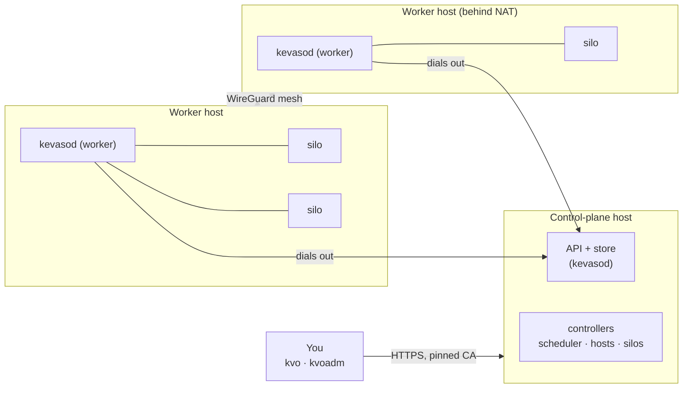

# Concepts

A few words come back on every page. Here they are, once, with how they fit together.

---

## The picture

- **You** talk to the API with `kvo` (using the platform) and `kvoadm` (running it).
- **The control plane** stores what you asked for and decides where things run.
- **Workers** run silos. They only ever dial *out* to the control plane, so a worker needs no open
  port, which is why a box behind a home router can be one.

---

## The words

| Word | What it is |
|---|---|
| **Host** | A machine Kevaso manages. It runs `kevasod` with one or both **components**: the *control plane* and the *worker*. |
| **kevasod** | The one program on every host. It is the API server, the controllers, the worker agent. Nothing of Kevaso's is installed inside a silo. |
| **Silo** | One isolated machine: a microVM or a container, with its own disk or volumes and its own address (the **silo IP**). It starts from a `container:` or a `vm:` block. Silos live in a namespace. |
| **Port** | A silo *declares* the ports it has in `spec.ports`. Nothing can reach one that isn't declared. |
| **Service** | What a silo opens of its declared ports: to which silos (`allowFrom`), on which of the host's addresses (`hostPort`), and for how long (`lease`). A service has a name; a silo with no service has none. A standalone `Service` object puts one stable address and name in front of several silos. A load balancer publishes a port only when those silos open it themselves. A port that opens only on a lease stays unpublished. |
| **Internal IP, external IP** | A host's address on its own network, and its address reachable from outside that network. You set them when you add the host; a host has at least one. |
| **Mesh IP** | A host's address on the encrypted network between hosts. Kevaso sets it. |
| **Silo IP** | A silo's own address inside the cluster. It changes when the silo changes host. |
| **Cluster IP** | The one stable address of a standalone `Service`. Never one silo's address. |
| **Name** | `SERVICE.NAMESPACE[.NETWORK].kevaso` for a service and `HOST.NETWORK.kevaso` for a host. See [Addresses, ports and names]({{ '/use/networking/model/' | relative_url }}). |
| **IP** (the kind) | An address you keep: it can outlive the silo or service that holds it. [Addresses you keep]({{ '/admin/ips/' | relative_url }}). |
| **Probe** | A check Kevaso runs against a silo to know it started, is ready and is still alive. [Probes]({{ '/use/silos/probes/' | relative_url }}). |
| **VMImage** | A versioned disk image a microVM silo can start from. Container silos name a registry image instead. |
| **Ingress** | A hostname and path routed to a service, through a stock proxy Kevaso drives. [HTTPS sites]({{ '/use/ingress/' | relative_url }}). |
| **Plugin** | A program that adds to Kevaso: a provider on a host, an operator for a kind you define, or a command for `kvo` ([Plugins for kvo]({{ '/use/kvo-plugins/' | relative_url }})). |
| **Runtime** | What a silo is made of: `cloud-hypervisor` (microVM), `openshell` / `openshell-container` (OpenShell sandboxes), `docker` / `podman` (containers). See [Runtimes]({{ '/use/silos/runtimes/' | relative_url }}). |
| **Namespace** | A folder for silos and the things they use (secrets, grants, OpenShell policies, roles). Access is given per namespace. |
| **Init steps** | Optional. Scripts that run inside a silo before it counts as Ready: install tools, clone a repo. They run on its first boot. With `everyBoot` they also run after a crash restart. `timeout` limits the steps of one start together. A silo with none is fine. |
| **Grant** | What a silo may reach outside the cluster and which secrets it gets, and how. Nothing outside is reachable without a Grant. An OpenShell sandbox can also reach what an OpenShellPolicy allows. A name is not followed to a private, mesh, link-local or loopback address unless the grant names that address. |
| **OpenShellPolicy** | Network rules for an OpenShell sandbox: a path, read-only or read-write access, REST, and which programs may use a rule. The silo lists names in `openshellPolicies`. [Runtimes]({{ '/use/silos/runtimes/#openshell-policies' | relative_url }}). |
| **Secret** | A value (an API key, a password, a signing key), or several under names (its keys: a user name and a password), kept encrypted. Silos get it only through Grants: injected on the way out, written as a file or an environment variable by the host, or asked for from a local endpoint. [Secrets]({{ '/use/secrets/' | relative_url }}). |
| **Control-plane loss** | A worker that can't reach the control plane changes nothing: its silos keep running. No other copy starts elsewhere until you say the old one is off (`kvo move … --confirm-fenced`, and `--recreate` when the silo must start fresh), or, for a silo that opted in with `onControlPlaneLoss: Stop`, until its host reports `FenceStopped`. [When the control plane is lost]({{ '/admin/control-plane-loss/' | relative_url }}) |
| **Context** | In `kvo`, a saved combination of cluster, identity and default namespace, like a kubeconfig context. |

---

## How a change happens

Everything in Kevaso is an object with a **spec** (what you want) and a **status** (what is):

1. You `kvo apply` a silo. The API checks it (types, rules, your permissions) and stores it.
2. The **scheduler** picks a host that fits (runtime installed, enough CPU and memory, labels,
   region) from the capacity that worker reports, and writes it into the silo's status.
3. That host's **agent** sees the silo, creates it with the runtime, starts it, runs its init steps (if it has any),
   and reports `Running` and `Ready`.
4. If anything drifts later (the VM dies, the host restarts), the agent puts it back. That's the
   loop: *declare, and Kevaso keeps it so*. If the control plane is out of reach, the agent changes
   nothing and the silos keep running as they were.

`kvo watch silos` shows these steps as they happen.

A `kevaso.com/` finalizer is removed only by Kevaso's own controllers, or through the admin socket
for a stuck one. A second `kvo apply` of a manifest keeps those finalizers. The exception is
`kevaso.com/plugin-uninstall`, which the person who uninstalls can remove.

---

## Two CLIs, on purpose

| | `kvo` | `kvoadm` |
|---|---|---|
| For | Using the platform | Running the platform |
| Like | `kubectl` | `kubeadm` |
| Talks to | The API, as you (certificate or signed-in token) | Machines over SSH (setup), and the API as a cluster admin |
| Examples | `apply`, `get`, `exec`, `login`, `create secret` | `init`, `host add`, `users invite`, `kms rotate` |
| Docs | [Using Kevaso]({{ '/use/' | relative_url }}) | [Administration]({{ '/admin/' | relative_url }}) |

---

## What Kevaso assumes

- **The machines are dedicated.** Kevaso owns the firewall, the silo bridge and its own services on
  them. Don't run other things on them that you'd mind it changing.
- **SSH is for setup only.** `kvoadm` logs in over SSH to install `kevasod`; after that, everything
  goes through the API, its permissions and its audit log.
- **Users get `editor`, admins do the rest.** A plain `kvo` is an `editor`: it makes and changes
  silos and what goes with them. Namespaces, roles, hosts, and opening things to the outside are an
  admin's. The cluster admin runs those as `kvoadm kvo …`, with the certificate `kvoadm` keeps.
- **Default deny.** A silo reaches nothing outside the cluster, and no other silo reaches it, until a
  rule says so: a grant for what it reaches, `allowFrom` on a service port for who reaches it.
