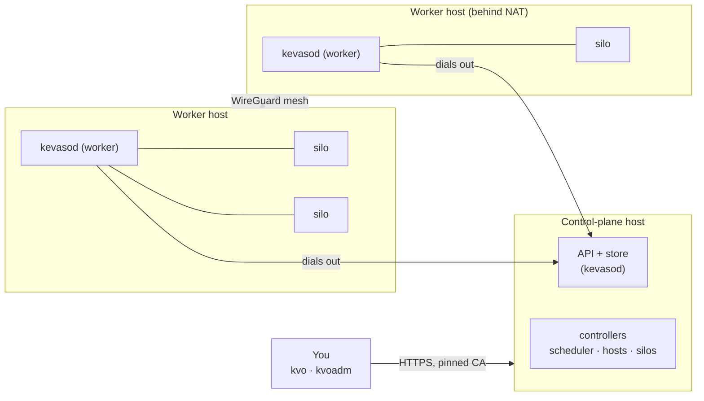

# Concepts

A few words come back on every page. Here they are, once, with how they fit together.

---

## The picture

- **You** talk to the API with `kvo` (using the platform) and `kvoadm` (running it).
- **The control plane** stores what you asked for and decides where things run.
- **Workers** run silos. They only ever dial *out* to the control plane, so a worker needs no open
  port, which is why a box behind a home router can be one.

---

## The words

| Word | What it is |
|---|---|
| **Host** | A machine Kevaso manages. It runs `kevasod` with one or both **components**: the *control plane* and the *worker*. |
| **kevasod** | The one program on every host. It is the API server, the controllers, the worker agent and, inside a VM, the guest helper `kvo-guest`. |
| **Silo** | One isolated machine: a microVM or a container, with its own disk or volumes, address and name. Silos live in a namespace. |
| **Runtime** | What a silo is made of: `cloud-hypervisor` (microVM), `openshell` / `openshell-container` (NVIDIA OpenShell sandboxes), `docker` / `podman` (containers). See [Runtimes]({{ '/silos/runtimes/' | relative_url }}). |
| **Namespace** | A folder for silos and the things they use (secrets, grants, roles). Access is given per namespace. |
| **Init steps** | Scripts that run inside a new silo before it counts as Ready: install tools, clone a repo. |
| **Grant** | What a silo may reach outside the cluster and which secrets it gets, and how. Nothing outside is reachable without one. |
| **Secret** | A value (an API key, a password, a signing key) kept encrypted. Silos get it only through Grants. |
| **Context** | In `kvo`, a saved combination of cluster, identity and default namespace, like a kubeconfig context. |

---

## How a change happens

Everything in Kevaso is an object with a **spec** (what you want) and a **status** (what is):

1. You `kvo apply` a silo. The API checks it (types, rules, your permissions) and stores it.
2. The **scheduler** picks a host that fits (runtime installed, enough CPU and memory, labels,
   region) and writes it into the silo's status.
3. That host's **agent** sees the silo, creates it with the runtime, starts it, runs its init steps,
   and reports `Running` and `Ready`.
4. If anything drifts later (the VM dies, the host restarts), the agent puts it back. That's the
   loop: *declare, and Kevaso keeps it so*.

`kvo watch silos` shows these steps as they happen.

---

## Two CLIs, on purpose

| | `kvo` | `kvoadm` |
|---|---|---|
| For | Using the platform | Running the platform |
| Like | `kubectl` | `kubeadm` |
| Talks to | The API, as you (certificate or signed-in token) | Machines over SSH (setup), and the API as a cluster admin |
| Examples | `apply`, `get`, `exec`, `login`, `create secret` | `check`, `init`, `host add`, `users invite`, `kms rotate` |

---

## What Kevaso assumes

- **The machines are dedicated.** Kevaso owns the firewall, the silo bridge and its own services on
  them. Don't run other things on them that you'd mind it changing.
- **SSH is for setup only.** `kvoadm` logs in over SSH to install `kevasod`; after that, everything
  goes through the API, its permissions and its audit log.
- **Default deny.** A silo reaches nothing outside the cluster, and no other silo reaches it, until a
  rule says so.
