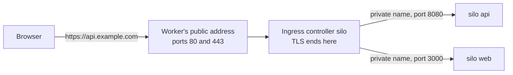

# HTTPS sites (ingress)

One public address, ports 80 and 443, many sites. An **ingress controller** reads HTTP, ends TLS,
and sends each request to the right silo by host name and path. The silos themselves stay private.



Compare with [`hostPort`]({{ '/networking/' | relative_url }}#open-to-the-internet): that forwards
raw TCP or UDP to **one** silo; an ingress reads HTTP and routes to **many**.

---

## The pieces

| Object | What it is |
|---|---|
| **Ingress controller** | An ordinary silo from Kevaso's `kevaso-ingress` image (`kvo-guest ingress`), exposed on 80 and 443 |
| **IngressClass** | Which silo serves a class of Ingresses, and whether the class is public |
| **Ingress** | Host names and paths → a silo's port, and where its certificate comes from |
| **Issuer** | Where certificates come from: an ACME server (Let's Encrypt) or the cluster's own CA |
| **Certificate** | Made for each Ingress with TLS; issued into a Secret and renewed by Kevaso |

Two issuers exist from the start: `letsencrypt` and `internal-ca`.

---

## 1 · The controller

A silo like any other, in a namespace of its own:

```yaml
apiVersion: kevaso/v1
kind: Namespace
metadata: { name: kevaso-system }
---
apiVersion: kevaso/v1
kind: Silo
metadata: { name: ingress-public, namespace: kevaso-system }
spec:
  runtime: docker
  image: kevaso-ingress          # Kevaso's own image: built on each host from kevasod, never pulled
  service:
    ports:
      - { name: http,  port: 80 }
      - { name: https, port: 443 }
    expose: hostPort
```

On a `cloud-hypervisor` silo, run it as a service with an init step instead:

```yaml
  init:
    steps:
      - name: ingress
        run: kvo-guest ingress --install
```

The controller gets its routes and certificates from its host, over its own private channel: a silo
that isn't a class's controller gets nothing. It runs with the same isolation as any silo: nothing
is mounted into it beyond that channel and the CA bundle.

> One controller silo with `expose: hostPort` is the simple shape. A SiloSet of controllers behind a
> standalone Service ([Sets, images and updates]({{ '/silos/sets/' | relative_url }})) is where this
> is heading, so a class survives losing one.

## 2 · The class

```yaml
apiVersion: kevaso/v1
kind: IngressClass
metadata: { name: public }
spec:
  controller: { silo: ingress-public, namespace: kevaso-system }
  public: true
```

A class says who serves it and whether it's public; where certificates come from is each Ingress's
choice (below).

> **Publishing on a public class is its own permission:** `create` on `ingresses/publish-public`
> in the namespace. Namespace `admin`s have it, `editor`s don't, so nobody puts something on the
> internet by accident.

## 3 · A site

The app, private (no `expose`):

```yaml
apiVersion: kevaso/v1
kind: Silo
metadata: { name: api, namespace: payments }
spec:
  runtime: docker
  image: docker.io/library/python:3.12-slim
  command: [python3, -m, http.server, "8080"]
  service:
    ports: [{ name: http, port: 8080 }]
```

And its Ingress:

```yaml
apiVersion: kevaso/v1
kind: Ingress
metadata: { name: api, namespace: payments }
spec:
  ingressClass: public
  hosts: [api.example.com]
  rules:
    - { path: /, silo: { name: api, port: http } }
```

```bash
kvo apply -f api.yaml
```

The Ingress opens exactly one path through the firewall: from the class's controller to `api`'s
`http` port. Nothing else can reach `api`.

## 4 · DNS

Point the host name at the controller's address. `kvo` shows it:

```bash
kvo get ingresses -n payments
```

```
NAME   CLASS    HOSTS             ADDRESS        READY
api    public   api.example.com   203.0.113.10   no (CertificatePending)
```

Make an `A` record `api.example.com → 203.0.113.10` at your DNS provider.

## 5 · The certificate

As soon as the name points at the controller, Kevaso gets a certificate from Let's Encrypt (HTTP-01:
Let's Encrypt fetches a token from the controller on port 80), stores it in a Secret, and the
controller serves it:

```bash
kvo get certificates -n payments
```

```
NAME      HOSTS             ISSUER        EXPIRES      READY
api-tls   api.example.com   letsencrypt   2027-02-10   yes
```

It's renewed by itself at two thirds of its life (after 60 of Let's Encrypt's 90 days).
`kvo describe certificate api-tls -n payments` shows its dates and, if something's wrong, why.

Now `https://api.example.com` reaches the silo, and `http://` redirects to it.

---

## Routes

| Field | Means |
|---|---|
| `hosts` | The names this Ingress answers for |
| `rules[].path` | A path prefix; the longest matching one wins (`/admin` before `/`) |
| `rules[].silo` | A silo in the Ingress's namespace, and the name of one of its service ports |
| `tls.issuer` | The Issuer its certificate comes from. Without one: the cluster's default for the class, `letsencrypt` on public classes and `internal-ca` on private ones (`kevasod --default-issuer-public` / `--default-issuer-private`) |
| `tls.secretName` | A certificate you keep yourself, in that Secret (chain and key, PEM): no certificate is made |
| `tls.none` | `true`: plain HTTP, on private classes only |

At most one of the three.

The app sees the original `Host` and the browser's address in `X-Forwarded-For`.

---

## Where certificates come from

An **Issuer** names a **cert-controller**: the part that turns a request for some host names into a
certificate. Kevaso does the rest: it decides when a certificate is needed and when to renew it,
makes the private key, and keeps the result in a Secret. A cert-controller only ever gets a
certificate signing request (CSR), never the key.

Built in:

| Cert-controller | Gets certificates from |
|---|---|
| `acme` | An ACME server: Let's Encrypt, or your own. Proves each host with an HTTP-01 or DNS-01 solver |
| `internal-ca` | The cluster's own CA, for private names. No proof needed |

You can add your own on the control-plane host: see [Other tools](#other-tools-certbot-and-friends).

### Your own ACME server

An Issuer can point at any ACME server, with its CA if it's private:

```yaml
apiVersion: kevaso/v1
kind: Issuer
metadata: { name: company-acme }
spec:
  acme:
    server: https://acme.internal.example.com/directory
    email: ops@example.com
    serverCA: |
      -----BEGIN CERTIFICATE-----
      …
```

Use it from an Ingress with `tls: { issuer: company-acme }`.

### Solvers: proving you own a name

Before an ACME server signs, you prove you control each host name. An Issuer lists **solvers**;
each host uses the most specific one that matches it.

| Solver | How the proof works | Good for |
|---|---|---|
| `http01` | The ACME server fetches a token from `http://HOST/.well-known/acme-challenge/…`; the ingress controller answers | Any public host pointing at the controller. The default |
| `dns01` | You publish a `TXT` record at `_acme-challenge.HOST` | Wildcards (`*.example.com`), and hosts nothing can reach on port 80 |

```yaml
apiVersion: kevaso/v1
kind: Issuer
metadata: { name: letsencrypt-dns }
spec:
  acme:
    server: https://acme-v02.api.letsencrypt.org/directory
    email: ops@example.com
    solvers:
      - http01: {}
      - selector:
          dnsZones: [internal.example.com]
        dns01:
          provider: bind
      - selector:
          dnsNames: [status.example.com]
        dns01:
          provider: bind
          propagationSeconds: 120
```

Which solver a host gets:

1. one whose `dnsNames` lists it exactly;
2. otherwise the one with the longest matching `dnsZones` (`db.internal.example.com` and
   `*.internal.example.com` are both in the zone `internal.example.com`);
3. otherwise one with no `selector`.

A host that matches none fails, and `kvo describe certificate` says so.

`propagationSeconds` is how long Kevaso waits after writing the record before asking the ACME
server to check it (default 60). Raise it if your DNS host is slow to publish.

### DNS providers

A dns01 solver names a **DNS provider**: a program on the control-plane host that writes and
removes `TXT` records at your DNS host. Kevaso runs it like this:

```
PROGRAM present _acme-challenge.status.example.com. VALUE
PROGRAM cleanup _acme-challenge.status.example.com. VALUE
```

The name ends with a dot. It's the same convention as lego's `exec` provider, so scripts written
for lego work here.

Any program in `/etc/kevaso/dns-providers/` is a provider, named after its file. For example, for a
DNS server that accepts dynamic updates (BIND, Knot, PowerDNS), save this as
`/etc/kevaso/dns-providers/bind` on the control-plane host:

```sh
#!/bin/sh
set -eu
case "$1" in
  present) action=add ;;
  cleanup) action=delete ;;
  *) exit 2 ;;
esac
nsupdate -k /etc/kevaso/bind-update.key <<EOF
server ns1.example.com
update $action $2 60 TXT "$3"
send
EOF
```

Make it root's and not writable by anyone else, then restart Kevaso so it's picked up:

```bash
sudo chown root:root /etc/kevaso/dns-providers/bind
```

```bash
sudo chmod 0755 /etc/kevaso/dns-providers/bind
```

```bash
sudo systemctl restart kevasod
```

The control plane runs these programs as root, so it refuses to start if one of them, or the
folder, can be changed by another user.

> **Why programs on the host, and not in the Issuer?** Otherwise anything that can create an
> Issuer could make the control plane run a command. An Issuer can only *name* a provider that
> whoever runs the host installed. DNS API credentials stay in files on that host, next to the
> program, never in the API.

### Wildcards

A wildcard needs DNS-01. Ask for it with a Certificate of its own:

```yaml
apiVersion: kevaso/v1
kind: Certificate
metadata: { name: internal-wildcard, namespace: payments }
spec:
  hosts: ["*.internal.example.com"]
  issuer: letsencrypt-dns
  secretName: internal-wildcard-tls
```

The certificate and its key land in the Secret `internal-wildcard-tls`, renewed like any other.

### Other tools: certbot and friends

When you'd rather use a tool you already have, register it as a cert-controller. Any program in
`/etc/kevaso/cert-controllers/` is one, named after its file. Kevaso runs it as `PROGRAM issue` and
writes the request to its standard input as JSON:

```json
{
  "issuer": "certbot",
  "config": { "email": "ops@example.com" },
  "hosts": ["api.example.com"],
  "csr": "-----BEGIN CERTIFICATE REQUEST-----\n…"
}
```

It reads the certificate chain back from the program's standard output, in PEM, the site's
certificate first. Whatever the program prints to standard error goes to Kevaso's log. `config` is
whatever the Issuer gives it.

For example, certbot with its Cloudflare plugin, as `/etc/kevaso/cert-controllers/certbot`:

```sh
#!/bin/sh
set -eu
[ "$1" = issue ] || exit 2
work=$(mktemp -d)
trap 'rm -rf "$work"' EXIT

request=$(cat)
echo "$request" | jq -r .csr > "$work/request.pem"
email=$(echo "$request" | jq -r .config.email)

certbot certonly --non-interactive --agree-tos --email "$email" \
  --csr "$work/request.pem" \
  --dns-cloudflare --dns-cloudflare-credentials /etc/kevaso/cloudflare.ini \
  --config-dir /var/lib/kevaso/certbot --work-dir "$work/run" --logs-dir /var/log/kevaso-certbot \
  --cert-path "$work/cert.pem" --chain-path "$work/chain.pem" \
  --fullchain-path "$work/fullchain.pem" >&2

cat "$work/fullchain.pem"
```

Same ownership rules as DNS providers. Then an Issuer that uses it:

```yaml
apiVersion: kevaso/v1
kind: Issuer
metadata: { name: certbot }
spec:
  controller: certbot
  config:
    email: ops@example.com
```

certbot gets only the CSR, so it never sees the key Kevaso keeps.
