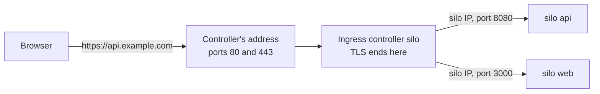

# HTTPS sites (ingress)

One address, ports 80 and 443, many sites. An **ingress controller** reads HTTP, ends TLS, and sends
each request to the right service by host name and path. The silos themselves stay private.



Compare with a [`hostPort`]({{ '/networking/' | relative_url }}#on-the-hosts-address-hostport): that forwards raw
TCP or UDP to **one** silo; an ingress reads HTTP and routes to **many**.

---

## The pieces

| Object | What it is |
|---|---|
| **Ingress controller** | An ordinary silo running a stock proxy as its vendor ships it, with its ports 80 and 443 open on its host or a load balancer |
| **IngressClass** | Which silo serves a class of Ingresses, with which proxy driver, whether the class is public, and which host names each namespace may publish |
| **Ingress** | Host names and paths → a service's port, and where its certificate comes from |
| **Issuer** | Where certificates come from: an ACME server (Let's Encrypt) or the cluster's own CA |
| **Certificate** | Made for each Ingress with TLS; issued into a Secret and renewed by Kevaso |

Two issuers exist from the start: `letsencrypt` and `internal-ca`.

The proxy is stock: Kevaso adds no program, token, socket or certificate authority to its silo, and the
proxy never calls Kevaso. A **driver** turns the class's routes, certificates and ACME challenges into
the proxy's own configuration. The host of the controller's silo writes it into the silo, checks it
with the proxy's own test, and reloads the proxy.

---

## 1 · The controller

One command makes a controller silo and its class:

```bash
kvoadm ingress install --public --host api.example.com=payments
```

```text
→ Namespace kevaso-system
→ Silo ingress-public
→ IngressClass public
Ingress class public: nginx (docker.io/library/nginx:1.27) in silo kevaso-system/ingress-public, on its host's external IP. Kevaso writes its config from outside;
see it with: kvo get ingressclass public -o yaml
```

A host name is published only when the class assigns it to the Ingress's namespace. Without
`--host`, the command still makes the class and then says no host is assigned yet. An Ingress is
refused until one is.

It runs as an admin of your current `kvo` context. Anything that already exists is left as it is.
The silo is in the namespace `kevaso-system`, named `ingress-CLASS`, with 1 CPU and 256Mi.

| Flag | Meaning | Default |
|---|---|---|
| `--class NAME` | The IngressClass to make | `public` |
| `--driver NAME` | The proxy: `nginx`, `caddy` or `kong` | `nginx` |
| `--public` | The class is reachable from the internet (publishing on it needs its own permission, below) | private |
| `--host-port internal\|external` | Open the proxy's ports on its host's internal or external address | `external` |
| `--lb-class CLASS` | Open them on a load balancer of that class instead (not with `--host-port`) | |
| `--image REF` | The proxy's image | The driver's vendor image |
| `--runtime NAME` | The silo's runtime | `docker` |
| `--option KEY=VALUE` | A driver option, repeatable (see below) | |
| `--host NAME=NAMESPACE[,NAMESPACE]` | Assign that host name to those namespaces. Repeat the flag for another name. `NAME` may be a one-label suffix, `*.example.com` | none: the class assigns no host, and an Ingress is refused until one is |
| `--cluster NAME` | The cluster folder to act from | The only one, or `$KVOADM_CLUSTER` |

The host that runs it needs the runtime and, with `--host-port external`, an external IP.

### The drivers

| Driver | Image | Ports | How a change takes effect |
|---|---|---|---|
| `nginx` | `docker.io/library/nginx:1.27` | 80, 443 | One `nginx.conf`, checked with `nginx -t`, then `nginx -s reload` |
| `caddy` | `docker.io/library/caddy:2.8` | 80, 443 | A Caddyfile with Caddy's automatic HTTPS off, checked with `caddy validate`, then `caddy reload` |
| `kong` | `docker.io/library/kong:3.7` | 8000, 8443 | Kong without a database: the whole config sent to its admin API, which checks and swaps it in one step |

`kvoadm ingress install` is made for `nginx` and `caddy`. Kong's image needs `KONG_DATABASE=off` and an
admin listener, so for Kong you bring your own silo and name it in the class (below). The admin API is
called from the host on the silo IP, so keep its port closed to everything else.

**Options** go in the class (`spec.controller.options`, or `--option`). A name the driver doesn't know,
or a value it won't take, is refused.

| Driver | Option | Meaning (default) |
|---|---|---|
| `nginx` | `user` | The user worker processes run as (`nginx`) |
| | `pid` | The pid file the image's nginx uses (`/run/nginx.pid`) |
| | `worker-connections` | Per worker (`1024`) |
| | `client-max-body-size` | Largest request body (`16m`) |
| | `proxy-connect-timeout` | To a backend (`5s`) |
| | `proxy-read-timeout` | Between two reads from a backend (`60s`) |
| | `proxy-send-timeout` | Between two writes to a backend (`60s`) |
| | `http2` | On 443, nginx 1.25.1 or later: `true` or `false` (`false`) |
| `caddy` | `dial-timeout` | To a backend (`5s`) |
| | `read-header-timeout` | For a client's request headers (`30s`) |
| | `idle-timeout` | A kept-alive client connection (`2m`) |
| `kong` | `admin-port` | Where Kong's admin API listens in the silo (`8001`) |
| | `connect-timeout`, `read-timeout`, `write-timeout` | To a backend (`5s`), between two reads (`60s`), between two writes (`60s`) |

**Annotations** go on an Ingress, prefixed with the driver's name, and only that driver reads them. An
annotation for another driver is ignored.

| Driver | Annotation | Meaning |
|---|---|---|
| `nginx` | `nginx/proxy-body-size` | Largest request body on this Ingress's routes |
| | `nginx/proxy-connect-timeout`, `nginx/proxy-read-timeout`, `nginx/proxy-send-timeout` | Timeouts for this Ingress |
| | `nginx/ssl-redirect` | `false`: also serve these routes on plain HTTP instead of redirecting |
| | `nginx/buffering` | `false`: stream responses as they come (server-sent events) |
| `caddy` | `caddy/dial-timeout` | To a backend |
| | `caddy/flush-interval` | `-1`: stream responses as they come, or a duration such as `500ms` |
| | `caddy/ssl-redirect` | `false`: also serve these routes on plain HTTP |
| `kong` | `kong/connect-timeout`, `kong/read-timeout`, `kong/write-timeout` | Timeouts for this Ingress |
| | `kong/strip-path` | `true`: drop the matched path prefix before passing the request on |
| | `kong/ssl-redirect` | `false`: also serve these routes on plain HTTP |

### Your own controller silo

Any silo can be the controller: run the proxy image as shipped, open its ports, and name the silo in
the class. `controller.siloSet` names a SiloSet instead: every instance gets the same configuration.

```yaml
apiVersion: kevaso/v1
kind: Silo
metadata: { name: ingress-edge, namespace: kevaso-system }
spec:
  runtime: docker
  container: { image: docker.io/library/nginx:1.27 }
  resources: { cpu: 1, memory: 256Mi }
  ports:
    - { name: http,  port: 80 }
    - { name: https, port: 443 }
  service:
    ports:
      - { port: http,  hostPort: [external] }
      - { port: https, hostPort: [external] }
```

One silo is the controller of one class.

## 2 · The class

```yaml
apiVersion: kevaso/v1
kind: IngressClass
metadata: { name: public }
spec:
  controller:
    driver: nginx
    namespace: kevaso-system
    silo: ingress-public
    options: { client-max-body-size: 32m }
  public: true
  hosts:
    - { host: api.example.com, namespaces: [payments] }
    - { host: "*.example.com", namespaces: [payments, shop] }
```

| Field | Meaning |
|---|---|
| `controller.driver` | The proxy's driver: `nginx`, `caddy` or `kong` |
| `controller.namespace` | The namespace of the controller silo (required) |
| `controller.silo` or `controller.siloSet` | The silo, or the SiloSet whose instances all run the proxy (one of the two) |
| `controller.options` | The driver's options |
| `public` | Reachable from the internet |
| `hosts` | Which namespaces may publish which names. `host` is a host name, or a one-label suffix such as `*.example.com` (that matches `a.example.com`, and not `example.com` or `b.a.example.com`). `namespaces` lists the namespaces allowed |
| `dns` | `{ provider, ttl }`: publish every host name of this class through a DNS provider, pointing at the controller's address. `ttl` is in seconds (300). The provider comes from a [provider plugin]({{ '/extending/plugins/' | relative_url }}); its page says how |

Only a cluster admin writes an IngressClass, which is where the assignment lives. On a class that
is already there:

```bash
kvoadm ingress assign public --host api.example.com=payments
```

```text
→ IngressClass public assigns api.example.com to payments
```

`--host` is `NAME=NAMESPACE[,NAMESPACE]`, and it can be repeated. The same flag on
`kvoadm ingress install` records the assignment on the class it creates. A class that already
exists is left as it is; the command tells you to add the host with `ingress assign`.

Where certificates come from is each Ingress's choice (below).

> **Publishing on a public class is its own permission:** `create` on `ingresses/publish-public`
> in the namespace. Namespace `admin`s have it, `editor`s don't, so nobody puts something on the
> internet by accident.

## 3 · A site

The app. It declares its port, and its service opens that port. With no `allowFrom` and no `hostPort`,
nothing reaches it except what an Ingress adds:

```yaml
apiVersion: kevaso/v1
kind: Silo
metadata: { name: api, namespace: payments }
spec:
  runtime: docker
  container:
    image: docker.io/library/python:3.12-slim
    command: [python3, -m, http.server, "8080"]
  ports:
    - { name: http, port: 8080 }
  service:
    ports: [{ port: http }]
```

And its Ingress, which names the **service** and one of its ports:

```yaml
apiVersion: kevaso/v1
kind: Ingress
metadata: { name: api, namespace: payments }
spec:
  ingressClass: public
  hosts: [api.example.com]
  rules:
    - { path: /, service: { name: api, port: http } }
```

```bash
kvo apply -f api.yaml
```

The class must already assign `api.example.com` to `payments`. Otherwise the API refuses the Ingress
with status 422:

```text
host "api.example.com" is not assigned to namespace payments on ingress class public: set IngressClass.spec.hosts, or add one with: kvoadm ingress assign public --host api.example.com=payments
```

The Ingress opens exactly one path through the firewall: from the class's controller to the silo's
`http` port. Nothing else can reach it. The service can be a silo's own (its `service.name`, or the
silo's name) or a standalone `Service`, which sends to every silo it selects. A `LoadBalancer`
Service publishes outside only ports those silos already open, and not a port that opens only on
a lease: a silo that doesn't is left out of it. If the silo is held
back by [`routeWhen`]({{ '/silos/probes/' | relative_url }}), or isn't running, its route is left out until it is
routed again.

## 4 · DNS

Point the host name at the controller's address. `kvo` shows it:

```bash
kvo get ingresses -n payments
```

```text
NAME   CLASS    HOSTS             ADDRESS        READY
api    public   api.example.com   203.0.113.10   no (CertificatePending)
```

The address is the controller's load-balancer address, else its host's external IP, else its internal
IP. Make an `A` record `api.example.com → 203.0.113.10` at your DNS provider, or set `dns` on the class
and a provider plugin does it.

## 5 · The certificate

As soon as the name points at the controller, Kevaso gets a certificate from Let's Encrypt (HTTP-01:
Let's Encrypt fetches a token from the controller on port 80), stores it in a Secret, and the
controller serves it:

```bash
kvo get certificates -n payments
```

```text
NAME      HOSTS             ISSUER        EXPIRES      READY
api-tls   api.example.com   letsencrypt   2027-02-10   yes
```

It's renewed by itself at two thirds of its life (after 60 of Let's Encrypt's 90 days). A failed
attempt waits a minute, then doubles up to an hour, so a broken setup doesn't hammer the CA.
`kvo describe certificate api-tls -n payments` shows its dates and, if something's wrong, why.

Now `https://api.example.com` reaches the silo. `http://` is redirected to it with a `308`, and a
request for a host no Ingress names gets a `404` (`nginx` and `caddy`).

---

## Routes

| Field | Means |
|---|---|
| `ingressClass` | The class that serves it (required) |
| `hosts` | The names this Ingress answers for |
| `rules[].path` | A path prefix, starting with `/`; the longest matching one wins (`/admin` before `/`). Default `/` |
| `rules[].service` | `{ name, port }`: a service's name and one of its ports, by name |
| `tls.issuer` | The Issuer its certificate comes from. Without one: the cluster's default for the class, `letsencrypt` on public classes and `internal-ca` on private ones (`kevasod control-plane --default-issuer-public` / `--default-issuer-private`) |
| `tls.secretName` | A certificate you keep yourself, in that Secret (chain and key, PEM): no certificate is made |
| `tls.none` | `true`: plain HTTP, on private classes only |

At most one of the three `tls` fields. Two Ingresses that claim the same host and path: the first by
name keeps it, and the other's route is left out.

The app sees the original `Host`. `nginx` and `caddy` pass the client's address in `X-Real-IP`, and `nginx` also in `X-Forwarded-For`.

---

## When the proxy refuses a configuration

A new configuration is checked inside the silo, with the proxy's own test, **before** the running proxy
sees it. **One broken Ingress holds back only itself.** An Ingress that its driver refuses (an
annotation it doesn't know, a bad value, a host name or path it can't take), that won't render, or
that makes the proxy's test fail is left out with the reason. Every other Ingress of the class, new
ones included, is applied, and the class keeps issuing and renewing certificates. An Ingress that was
already being served keeps being served in its last good version; only the change is held back.

| Where | What it shows |
|---|---|
| `kvo get ingressclass NAME -o yaml` | `status.controllers[]`, one per controller silo: `applied` (the configuration in effect), `rejected` (one segment per Ingress that is left out: `ingress NAMESPACE/NAME: why; ingress …`), `blamed` (those Ingresses). The condition `Applied` is false with the reason `Rejected` while any Ingress is left out, although the rest is served |
| `kvo get ingresses` | The Ingress that caused it has `READY` false. `Rejected`: the proxy blamed it. `Refused`: its driver refuses an annotation or a value before it gets that far |
| `kvo describe ingress NAME` | Its conditions, with the reason and message |

Other reasons an Ingress isn't ready: `NoClass` (the class doesn't exist), `NoDriver` (the class names
a driver this cluster doesn't have) and `CertificatePending`.

Values are checked before they reach the configuration: nothing is quoted or escaped for you.

An Ingress the proxy refused is left out and tried again on a backoff, with no change required.
The first try is 30 seconds later. Each refusal after that doubles the wait, up to 10 minutes, and
it stays at 10 minutes while the proxy still refuses. Once the proxy accepts it, it is served and
the status clears. The other Ingresses of the class keep being served the whole time. Applying a
fix is checked on the next pass, without waiting out the backoff.

### How the broken one is found

When the proxy refuses the whole configuration, Kevaso looks for the Ingress at fault:

1. It takes the proxy's own blame, when the proxy names one.
2. Otherwise it tests the Ingresses changed since the last good configuration, each on its own and by
   halving, on the side (the proxy's test is run on files that are not the running ones). It spends at
   most **12** test runs per change.
3. An Ingress the 12 runs did not reach is `not checked yet: finding the Ingress the proxy refuses
   took more than 12 test runs`: it is not served, and tried again on the next pass.

Kong has no test on the side: applying the previous state plus some changes is its test, which never
drops a route that was working. An unchanged state costs no test run until the backoff above is due.
A refused Ingress is tried again on that backoff even when it and the class's options are unchanged.

### When the whole class is held

A class is **held** only when the proxy refuses even the configuration with none of your Ingresses
in it: the class's own part, its options or its challenges. (This is not the same as a silo held back
by `routeWhen`.) Nothing new is applied and the last good configuration keeps being served. The class
shows `rejected` as `held (the last good configuration stays): the proxy refuses even the class's own
part: …`. Fixing the class's options releases it.

| While left out or held | |
|---|---|
| Still served | The last good routes and certificates, new valid Ingresses (not while the whole class is held), and **ACME HTTP-01 challenges**, so one tenant's bad annotation does not stop certificates being issued or renewed |
| Not served | The broken Ingress's change (its last good version stays), a changed class option while held |

The controller silo keeps a record of what the proxy accepted. An agent restart reads that record
and checks it against what the proxy is running. A restart changes no route. A missing, truncated
or corrupted record does not by itself change what the proxy serves: the proxy is read first, and
a class is held rather than dropping a route that may still be there.

---

## Not proven yet

The drivers' output is checked in tests, including each proxy's own configuration test where its
program is on the machine, and an agent applying configurations to a fake runtime. On a real machine
with Let's Encrypt's staging server, nginx has been run, and a class refused for one annotation still
served its challenges. Not run on real machines: leaving out one broken Ingress while the others
are applied, the search for the broken one, DNS-01, and Kong's admin call from the host.
Not built: drivers from plugins, request limits and authentication in front of a route, TCP and UDP
routes, HTTP/3, and a proxy managing its own certificates.

---

## Where certificates come from

An **Issuer** names a **cert-controller**: the part that turns a request for some host names into a
certificate. Kevaso does the rest: it decides when a certificate is needed and when to renew it,
makes the private key, and keeps the result in a Secret. A cert-controller only ever gets a
certificate signing request (CSR), never the key.

Built in:

| Cert-controller | Gets certificates from |
|---|---|
| `acme` | An ACME server: Let's Encrypt, or your own. Proves each host with an HTTP-01 or DNS-01 solver |
| `internal-ca` | A CA of its own, for private names. No proof needed. See [The internal CA](#the-internal-ca) |

You can add your own on the control-plane host: see [Other tools](#other-tools-certbot-and-friends).

### The internal CA

`internal-ca` signs with its own CA, the files `internal-ca.crt` and `internal-ca.key` in
`/var/lib/kevaso/pki/`. It is not the cluster CA. A client that pins the cluster CA does not trust
it. The public certificate is served at `/internal-ca.crt`.

An API server's name is never signed: the host's name, its addresses, and the host of its API URL.

```text
host "203.0.113.10" is a name of this cluster's API server and is not signed
```

Any other name on a Certificate is kept only when an IngressClass assigns it to that namespace, or
it is one of the namespace's own service names (`NAME.payments.kevaso`, or with `.mesh`,
`.internal` or `.external` before the suffix). Otherwise:

```text
host "api.example.com" is not assigned to namespace payments on an ingress class, and is not one of its service names (NAME.payments.kevaso): ask a cluster admin to assign it
```

A worker reads `/internal-ca.crt`. A system node's own worker already has the certificate.

- A `docker` or `podman` silo gets it in the CA bundle the host mounts at
  `/etc/ssl/certs/kevaso-ca-bundle.crt`, together with the host's system CAs and the egress CA.
  `SSL_CERT_FILE`, `REQUESTS_CA_BUNDLE`, `CURL_CA_BUNDLE` and `NODE_EXTRA_CA_CERTS` point at that file.
- An OpenShell gateway gets it in `/etc/kevaso/openshell-upstream-cas.pem`, which the gateway's own
  user can read, and trusts that file upstream. The file is public certificates only. It is not
  kept in `/var/lib/kevaso`, which is root-only.

A microVM does not get this bundle. Its trust store is the image's, plus the egress CA when a grant
injects a secret.

### Your own ACME server

An Issuer can point at any ACME server, with its CA if it's private:

```yaml
apiVersion: kevaso/v1
kind: Issuer
metadata: { name: company-acme }
spec:
  acme:
    server: https://acme.internal.example.com/directory
    email: ops@example.com
    serverCA: |
      -----BEGIN CERTIFICATE-----
      …
```

Use it from an Ingress with `tls: { issuer: company-acme }`.

### Solvers: proving you own a name

Before an ACME server signs, you prove you control each host name. An Issuer lists **solvers**;
each host uses the most specific one that matches it.

| Solver | How the proof works | Good for |
|---|---|---|
| `http01` | The ACME server fetches a token from `http://HOST/.well-known/acme-challenge/…`; the ingress controller answers | Any public host pointing at the controller. The default |
| `dns01` | You publish a `TXT` record at `_acme-challenge.HOST` | Wildcards (`*.example.com`), and hosts nothing can reach on port 80 |

```yaml
apiVersion: kevaso/v1
kind: Issuer
metadata: { name: letsencrypt-dns }
spec:
  acme:
    server: https://acme-v02.api.letsencrypt.org/directory
    email: ops@example.com
    solvers:
      - http01: {}
      - selector:
          dnsZones: [internal.example.com]
        dns01:
          provider: bind
      - selector:
          dnsNames: [status.example.com]
        dns01:
          provider: bind
          propagationSeconds: 120
```

Which solver a host gets:

1. one whose `dnsNames` lists it exactly;
2. otherwise the one with the longest matching `dnsZones` (`db.internal.example.com` and
   `*.internal.example.com` are both in the zone `internal.example.com`);
3. otherwise one with no `selector`.

A host that matches none fails, and `kvo describe certificate` says so.

`propagationSeconds` is how long Kevaso waits after writing the record before asking the ACME
server to check it (default 60). Raise it if your DNS host is slow to publish.

### DNS providers

A dns01 solver names a **DNS provider**: a program on the control-plane host that writes and
removes `TXT` records at your DNS host. Kevaso runs it like this:

```
PROGRAM present _acme-challenge.status.example.com. VALUE
PROGRAM cleanup _acme-challenge.status.example.com. VALUE
```

The name ends with a dot. It's the same convention as lego's `exec` provider, so scripts written
for lego work here.

Any program in `/etc/kevaso/dns-providers/` is a provider, named after its file. Names are lowercase letters, digits and dashes. A provider program is stopped after 2 minutes. For example, for a
DNS server that accepts dynamic updates (BIND, Knot, PowerDNS), save this as
`/etc/kevaso/dns-providers/bind` on the control-plane host:

```sh
#!/bin/sh
set -eu
case "$1" in
  present) action=add ;;
  cleanup) action=delete ;;
  *) exit 2 ;;
esac
nsupdate -k /etc/kevaso/bind-update.key <<EOF
server ns1.example.com
update $action $2 60 TXT "$3"
send
EOF
```

Make it root's and not writable by anyone else, then restart Kevaso so it's picked up:

```bash
sudo chown root:root /etc/kevaso/dns-providers/bind
```

```bash
sudo chmod 0755 /etc/kevaso/dns-providers/bind
```

```bash
sudo systemctl restart kevasod
```

The control plane runs these programs as root, so it refuses to start if one of them, or the
folder, can be changed by another user.

> **Why programs on the host, and not in the Issuer?** Otherwise anything that can create an
> Issuer could make the control plane run a command. An Issuer can only *name* a provider that
> whoever runs the host installed. DNS API credentials stay in files on that host, next to the
> program, never in the API.

### Wildcards

A wildcard needs DNS-01. Ask for it with a Certificate of its own:

```yaml
apiVersion: kevaso/v1
kind: Certificate
metadata: { name: internal-wildcard, namespace: payments }
spec:
  hosts: ["*.internal.example.com"]
  issuer: letsencrypt-dns
  secretName: internal-wildcard-tls
```

The class has to assign that suffix to the namespace first (`hosts: [{ host: "*.internal.example.com", namespaces: [payments] }]`, or `kvoadm ingress assign`). The certificate and its key land in the Secret `internal-wildcard-tls`, renewed like any other.

### Other tools: certbot and friends

When you'd rather use a tool you already have, register it as a cert-controller. Any program in
`/etc/kevaso/cert-controllers/` is one, named after its file. Kevaso runs it as `PROGRAM issue` (stopped after 10 minutes) and
writes the request to its standard input as JSON:

```json
{
  "issuer": "certbot",
  "config": { "email": "ops@example.com" },
  "hosts": ["api.example.com"],
  "csr": "-----BEGIN CERTIFICATE REQUEST-----\n…"
}
```

It reads the certificate chain back from the program's standard output, in PEM, the site's
certificate first. Whatever the program prints to standard error goes to Kevaso's log. `config` is
whatever the Issuer gives it.

For example, certbot with a DNS plugin for your DNS host (here `DNSHOST`), as `/etc/kevaso/cert-controllers/certbot`:

```sh
#!/bin/sh
set -eu
[ "$1" = issue ] || exit 2
work=$(mktemp -d)
trap 'rm -rf "$work"' EXIT

request=$(cat)
echo "$request" | jq -r .csr > "$work/request.pem"
email=$(echo "$request" | jq -r .config.email)

certbot certonly --non-interactive --agree-tos --email "$email" \
  --csr "$work/request.pem" \
  --dns-DNSHOST --dns-DNSHOST-credentials /etc/kevaso/dnshost.ini \
  --config-dir /var/lib/kevaso/certbot --work-dir "$work/run" --logs-dir /var/log/kevaso-certbot \
  --cert-path "$work/cert.pem" --chain-path "$work/chain.pem" \
  --fullchain-path "$work/fullchain.pem" >&2

cat "$work/fullchain.pem"
```

Same ownership rules as DNS providers. Then an Issuer that uses it:

```yaml
apiVersion: kevaso/v1
kind: Issuer
metadata: { name: certbot }
spec:
  controller: certbot
  config:
    email: ops@example.com
```

certbot gets only the CSR, so it never sees the key Kevaso keeps.
