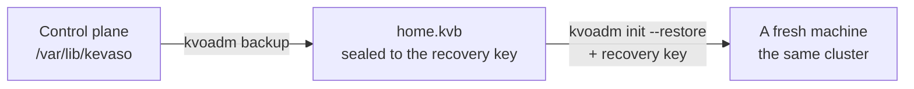

# Backup and restore

The control plane holds the cluster: every object, the secrets, the cluster CA, who may do what.
With a [single system node]({{ '/setup/' | relative_url }}), losing that machine loses all of it,
unless you have a **backup** and the **recovery key**.



---

## What a backup holds

| In it | Not in it |
|---|---|
| Every object: namespaces, silos, grants, ingresses, roles, users | What's *inside* silos: their disks and volumes |
| Secrets, still sealed | The master key file (rebuilt from the recovery key) |
| The cluster CA, so certificates and `kvo` contexts keep working | Workers' own state (they rebuild it) |
| The audit log | |

The file is sealed to the recovery key. The control plane can make a backup without the key, but
only the key opens one. A backup that leaks is useless on its own. A backup **and** the recovery key
together open every secret in it, so never keep the two in the same place.

Silo data is yours to back up from inside the silo (a database dump, `restic`, your volumes'
snapshots). After a restore, silos come back from their specs with empty disks.

---

## Take a backup

From your computer, with the same key you set the machine up with:

```bash
bin/kvoadm backup root@203.0.113.10 \
    --ssh-key ~/.ssh/kevaso_ed25519 \
    --host-key SHA256:kVvp5Yv9fNU4r4yX2P7+O99SU45jwdxC60ylimGFta4 \
    --output home-2026-11-12.kvb
```

```
→ connected to 203.0.113.10:22 (host key SHA256:kVvp5Yv9…)
→ backup written to home-2026-11-12.kvb (212 KiB), sealed to your recovery key
```

The control plane keeps running while it's taken. The file is readable only by you (`0600`), and
`kvoadm` never overwrites an existing one: give each backup its own name.

**How often:** after every change you'd hate to redo, and at least daily. It's small and quick.

**Where:** anywhere off the machine. Your laptop, a bucket, another provider. Not next to the
recovery key.

### Every day, automatically

A line in your computer's crontab (`crontab -e`) takes one at 03:00:

```
0 3 * * * cd ~/kevaso && bin/kvoadm backup root@203.0.113.10 --ssh-key ~/.ssh/kevaso_ed25519 --host-key SHA256:kVvp5Yv9fNU4r4yX2P7+O99SU45jwdxC60ylimGFta4 --output ~/backups/home-$(date +\%F).kvb
```

cron can't type a passphrase, so the key must be in `ssh-agent`, or be a key of its own without
one, kept just for this.

---

## Restore

The machine is gone. You have a backup file and the recovery key.

### 1 · A new machine

[Prepare it]({{ '/setup/prepare/' | relative_url }}) like the first one: your Kevaso key on it, its
fingerprint written down.

It can have the old machine's address (a reserved or floating IP you move over) or a new one. Each
worker remembers the address it reports to; with a new one, the restore points them at it (step 4).

### 2 · Restore onto it

`kvoadm init` with `--restore`:

```bash
bin/kvoadm init root@198.51.100.7 \
    --ssh-key ~/.ssh/kevaso_ed25519 \
    --host-key SHA256:pD6y1yfXq0b3m9GWkqk1n0x5S8yGe7mT1UuJb2cNqXE \
    --kevasod bin/kevasod-linux-amd64 \
    --restore home-2026-11-12.kvb
```

It asks for the recovery key, hidden as you type:

```
Recovery key
The KVR1-… key kvoadm init printed. It opens the backup.
> ••••••••••••••••••••••••••••••
```

**It checks the key against the file first**, on your computer, before touching the machine. A
wrong key or a damaged file stops it there:

```
kvoadm: restore: this recovery key doesn't open this backup (or the file was changed)
```

With the right key:

```
→ backup of cluster "home" (control plane hv1), taken 2026-11-12 03:00:04: the recovery key opens it
→ connected to 198.51.100.7:22 (host key SHA256:pD6y1yfX…)
→ kevasod installed (signature verified on the host)
→ backup restored into /var/lib/kevaso: store, cluster CA, and the master key rebuilt with the recovery key
→ control plane started (kevasod.service)
→ kvo context "home" written to /Users/you/.kevaso/config.yaml (server https://198.51.100.7:6443)
→ host hv1 is Ready. Try: kvo get hosts
→ the recovery key is still the one you restored with
→ worker hv2 reconnected (https://198.51.100.7:6443)
→ worker hv3 reconnected (https://198.51.100.7:6443)
```

The cluster and host names come from the backup (`--cluster` and `--name` override them). It
refuses a machine that already has a control plane on it.

In a script, pass the key on stdin, never as an argument (arguments end up in shell history and
`ps`):

```bash
bin/kvoadm init root@198.51.100.7 --ssh-key ~/.ssh/kevaso_ed25519 \
    --host-key SHA256:pD6y1yfX… --kevasod bin/kevasod-linux-amd64 \
    --restore home-2026-11-12.kvb < recovery-key.txt
```

### 3 · Check

```bash
bin/kvo get hosts
```

```bash
bin/kvo get silos -A
```

Secrets open again, and existing `kvo` contexts keep working: it's the same cluster CA. Anything changed after the backup was taken is gone; re-apply it.

If the machine also ran silos, they start again from their specs, with empty disks: restore their
data from your own backups of it.

### 4 · Workers

Workers weren't lost, and neither is what's on their disks. They only need to know where the
control plane is now.

A worker proves who it is with a certificate from the cluster CA, and the restored control plane
has the same CA, so it still trusts every worker. All that changes is one setting on each worker,
the address it reports to:

```
ExecStart=/usr/local/bin/kevasod worker --name hv2 --server https://198.51.100.7:6443 …
```

**The restore does this for you.** `kvoadm host add` noted how it reached each worker (its SSH
address and host key) on the worker's Host, so it's in the backup. After restoring, `kvoadm` logs in
to each worker with the same SSH key, changes the address, restarts it, and waits until it reports.
On the same address as before, there's nothing to change and the workers simply reconnect.

If it can't reach a worker (another SSH key, a machine that's off), it says which and what to run:

```
1 of 2 workers still point at the old control plane:

HOST   WHY                                         RUN
hv3    ssh: handshake failed: unable to authenticate   kvoadm host reconnect root@198.51.100.23 --ssh-port 22 --ssh-key KEY --server https://198.51.100.7:6443
```

Run it with the right key:

```bash
bin/kvoadm host reconnect root@198.51.100.23 \
    --ssh-key ~/.ssh/hv3_ed25519 \
    --server https://198.51.100.7:6443
```

```
→ host hv3 reports to https://198.51.100.7:6443 again
```

Without `--server`, it uses the control plane of your current `kvo` context. The host key is
checked against the one recorded when the worker was added.

The WireGuard mesh between hosts heals by itself: the restored control plane gets new mesh keys,
publishes them, and every worker picks them up.

---

## Either store

Backups look the same with the SQLite store and with [the etcd store]({{ '/operations/#the-store' | relative_url }}):
the same command, the same file, sealed to the same key. With etcd, `kevasod` writes the objects out
in SQLite's format for the backup (every object, with its revision).

A restore always starts the restored cluster on SQLite, because `kvoadm init --restore` installs
the default service. To go back to etcd, add `--store etcd` to it again. The first start moves the
restored store into etcd, once.

---

## Practise it

A restore you've never tried is a hope, not a plan. Every few months, restore your latest backup
onto a [throwaway local VM]({{ '/setup/local/' | relative_url }}), check that `kvo get silos -A`
looks right, then delete the VM. It also proves the recovery key you saved is the right one.

---

## If the recovery key leaks

Replace it, then make the old backups worthless:

```bash
bin/kvoadm kms rotate root@203.0.113.10 --ssh-key ~/.ssh/kevaso_ed25519 --new-recovery-key
```

Save the new key it prints, the same way as the first one. Then:

1. take a new backup;
2. delete the backups taken before, since the leaked key opens them;
3. change the secrets that matter (`kvo secret set NAME --from-file -`): whoever had the key and an
   old backup could have read them.
