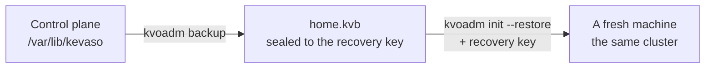

# Backup and restore

The control plane holds the cluster: every object, the secrets, the cluster CA, who may do what.
With a [single system node]({{ '/setup/' | relative_url }}), losing that machine loses all of it,
unless you have a **backup** and the **recovery key**.



---

## What a backup holds

| In it | Not in it |
|---|---|
| Every object: namespaces, silos, grants, ingresses, roles, users | What's *inside* silos: their disks and volumes |
| Secrets, still sealed | The master key file (rebuilt from the recovery key) |
| The cluster CA, so certificates and `kvo` contexts keep working | Workers' own state (they rebuild it) |
| The audit log | |

The file is sealed to the recovery key. The control plane can make a backup without the key, but
only the key opens one. A backup that leaks is useless on its own. A backup **and** the recovery key
together open every secret in it, so never keep the two in the same place.

Silo data is yours to back up from inside the silo (a database dump, `restic`, your volumes'
snapshots). After a restore, the host that still has a copy keeps it. The restored control plane
does not start a second copy until that silo is settled (below). A silo that ran only on the
machine you are replacing comes back from its spec, with an empty disk, once it is settled.

---

## Take a backup

From your computer, with the same key you set the machine up with:

```bash
bin/kvoadm backup root@203.0.113.10 \
    --ssh-key ~/.ssh/kevaso_ed25519 \
    --host-key SHA256:kVvp5Yv9fNU4r4yX2P7+O99SU45jwdxC60ylimGFta4 \
    --output home-2026-11-12.kvb
```

```
→ connected to 203.0.113.10:22 (host key SHA256:kVvp5Yv9…)
→ backup written to home-2026-11-12.kvb (212 KiB), sealed to your recovery key
```

The control plane keeps running while it's taken. The file is readable only by you (`0600`), and
`kvoadm` never overwrites an existing one: give each backup its own name.

**How often:** after every change you'd hate to redo, and at least daily. It's small and quick.

**Where:** anywhere off the machine. Your laptop, a bucket, another provider. Not next to the
recovery key.

### Every day, automatically

A line in your computer's crontab (`crontab -e`) takes one at 03:00:

```
0 3 * * * cd ~/kevaso && bin/kvoadm backup root@203.0.113.10 --ssh-key ~/.ssh/kevaso_ed25519 --host-key SHA256:kVvp5Yv9fNU4r4yX2P7+O99SU45jwdxC60ylimGFta4 --output ~/backups/home-$(date +\%F).kvb
```

cron can't type a passphrase, so the key must be in `ssh-agent`, or be a key of its own without
one, kept just for this.

---

## Restore

The machine is gone. You have a backup file and the recovery key.

### 1 · A new machine

[Prepare it]({{ '/setup/prepare/' | relative_url }}) like the first one: your Kevaso key on it, its
fingerprint written down.

It can have the old machine's address (a reserved or floating IP you move over) or a new one. Each
worker remembers the address it reports to; with a new one, the restore points them at it (step 5).

The token issuer is this node's reach address: its external IP, or its internal IP when it has no
external IP, as `https://203.0.113.10:6443`. A token's issuer has to match the node that checks it.
`kvoadm init`, a restore included, writes a unit without `--cluster-dns`, so a restore onto a new
address makes the issuer that new address. Sign-in tokens and service-account tokens from before
then no longer verify. People sign in again, and CI tokens are minted again.

Set `--cluster-dns` when the issuer should be a name, not an address. It is a flag of
`kevasod control-plane` and of `kvoadm host add --install control-plane`
([High availability]({{ '/operations/ha/#add-a-system-node' | relative_url }})). The name has one
record per system node. After a restore, the new unit does not set it: add `--cluster-dns` on the
control plane before you rely on tokens surviving the next new address.

### 2 · Restore onto it

`kvoadm init` with `--restore`, and exactly one statement of which hosts joined since the backup.
`--no-hosts-added` says none did. `--host-added NAME` names one that did, and you repeat it for
each. Both together are refused, and so is either flag on an init that is not a restore.

```bash
bin/kvoadm init root@198.51.100.7 \
    --ssh-key ~/.ssh/kevaso_ed25519 \
    --host-key SHA256:pD6y1yfXq0b3m9GWkqk1n0x5S8yGe7mT1UuJb2cNqXE \
    --kevasod bin/kevasod-linux-amd64 \
    --restore home-2026-11-12.kvb \
    --host-added hv3
```

No host joined since the backup:

```bash
bin/kvoadm init root@198.51.100.7 \
    --ssh-key ~/.ssh/kevaso_ed25519 \
    --host-key SHA256:pD6y1yfXq0b3m9GWkqk1n0x5S8yGe7mT1UuJb2cNqXE \
    --kevasod bin/kevasod-linux-amd64 \
    --restore home-2026-11-12.kvb \
    --no-hosts-added
```

Without one of those it stops before it touches the machine:

```text
kvoadm: kvoadm init --restore needs --no-hosts-added, or --host-added NAME for each host joined since the backup
```

It asks for the recovery key, hidden as you type:

```
Recovery key
The KVR1-… key kvoadm init printed. It opens the backup.
> ••••••••••••••••••••••••••••••
```

**It checks the key against the file first**, on your computer, before touching the machine. A
wrong key or a damaged file stops it there:

```
kvoadm: restore: this recovery key doesn't open this backup (or the file was changed)
```

With the right key:

```
→ backup of cluster "home" (control plane hv1), taken 2026-11-12 03:00:04: the recovery key opens it
→ connected to 198.51.100.7:22 (host key SHA256:pD6y1yfX…)
→ kevasod installed (signature verified on the host)
→ backup restored into /var/lib/kevaso: store, cluster CA, and the master key rebuilt with the recovery key
→ control plane started (kevasod.service)
→ cluster home: kvoadm's config and admin credential in /Users/you/.kevaso/clusters/home (server https://198.51.100.7:6443)
→ host hv1 is Ready. Try: kvoadm host list
→ the recovery key is still the one you restored with
→ worker hv2 reconnected (https://198.51.100.7:6443)
→ worker hv3 reconnected (https://198.51.100.7:6443)
restore: history 7c1e9a2b4d6f80a1c3e5b7091d2f4a68
hosts that have not reported: hv2, hv3
unsettled silos: shop/web
frozen silos: none
```

Those last four lines are the restore account. An empty list prints `none`. When a silo is frozen
the fourth line names each holder and prints one settle command per holder:

```text
restore: history 7c1e9a2b4d6f80a1c3e5b7091d2f4a68
hosts that have not reported: none
unsettled silos: none
frozen silos:
shop/web (copies on hv2, hv3)
kvoadm restore settle web -n shop --to hv2
kvoadm restore settle web -n shop --to hv3
```

The same four lines are `kvoadm restore status`, and `kvo restore status` when `kvo` has the context.

The cluster and host names come from the backup (`--cluster` and `--name` override them). A `--name`
the backup does not have is checked before anything is written, and refused unless this run passes
`--worker` and `--runtime` (and `--store`, when the store is etcd) or `--replace-unit`:

```text
kvoadm: the backup has no host "hv9" to take the worker and store from: pass --worker and --runtime (and --store, if it is etcd), or --replace-unit
```

It refuses a machine that already has a control plane on it.

In a script, pass the key on stdin, never as an argument (arguments end up in shell history and
`ps`):

```bash
bin/kvoadm init root@198.51.100.7 --ssh-key ~/.ssh/kevaso_ed25519 \
    --host-key SHA256:pD6y1yfX… --kevasod bin/kevasod-linux-amd64 \
    --restore home-2026-11-12.kvb --no-hosts-added < recovery-key.txt
```

### 3 · Wait until each silo is settled

Workers may stop silos. A copy that is already running stays running. A worker starts nothing that
is not already running until that silo is **settled** for the new history.

A silo is settled once every host the restored store had, and every host you named with
`--host-added`, has reported the copies it holds (running or kept stopped) in the new history, or
you have confirmed it off. A host with no worker counts as reported and holds nothing. A silo
created after the history started is settled at once.

Until then the silo stays pending. Controllers do not schedule it, and they do not attach or
detach its volumes. A volume removal recorded under another restore history is dropped, and the
provider volume is kept. A removal recorded under the open history is still done. `kvoadm restore status` shows what is still waiting.

One reported copy on the stored host leaves the placement there. One reported copy on the other
end of a stored handoff, or on a host a volume is already attached to, moves the placement there
when that handoff is not left in place. The host conditions are dropped, the silo IP is cleared,
and the phase is `Scheduled`. When the old host is still live and a volume is attached there, that
host is left to unmount and let go. No reported copy leaves the stored placement. The host that
still has the copy keeps it. The control plane does not start a second one. The silo may then start.

**Frozen** is two or more copies, or a move since the backup. A move is the only copy on a host the
restored records do not already name, while the stored host is live and holds nothing. A stored
handoff whose only copy is on neither end is frozen too. Placement stays, every disk stays, and
the condition `Frozen` is true with reason `RestoreConflict`. The message names each holder and
the command that picks it. Settle is for a cluster admin:

```bash
kvoadm restore settle web -n shop --to hv2
```

```text
waiting for hv3 to stop its copy
silo/web settled on hv2; the other copies stay stopped with their disks
```

The same write is `kvo restore settle web --to hv2 -n shop`. It places the silo on that host with
no handoff, so every other copy stops and keeps its disk. The host has to have reported a copy of
that silo under this history. A host you confirmed off starts nothing.

Settling waits for the other copies. Until every other holder reports its copy stopped, or you
confirm that host off, the silo stays frozen as `settling to hv2` and nothing starts it, on hv2
or anywhere else. `kvoadm restore status` shows `shop/web (settling to hv2)` meanwhile. If a holder
does not answer, settle stops waiting and says so:

```text
shop/web: waiting for hv3 to stop its copy: bring hv3 back, or run kvoadm host confirm-off hv3
```

A host the account is still waiting on, that is off or wiped:

```bash
kvoadm host confirm-off hv3
```

```text
Is hv3 off or wiped? [y/N]
```

Answer `y`. `--yes` or `--confirm-off` skips the question. The name does not have to be a Host
object. The same confirmation is `kvoadm host remove hv3 --confirm-off`: a host the open restore
still needs cannot be removed without it. Removing a host is on
[Removing a host]({{ '/workers/host-loss/#removing-a-host' | relative_url }}).

`kevasod admin restore` with no host statement still opens a new history. No silo from before that
history settles until a statement exists, which `kvoadm init --restore` writes from
`--no-hosts-added` or `--host-added`.

### 4 · Check

```bash
bin/kvoadm kvo get hosts
```

```bash
bin/kvo get silos -A
```

Secrets open again, and existing `kvo` contexts keep working: it's the same cluster CA. Anything changed after the backup was taken is gone; re-apply it.

A silo whose only copy was on the machine you replaced starts from its spec once it is settled,
with an empty disk. Restore that data from your own backup of it. A copy a worker still has keeps
running; the restored control plane does not start another.

### 5 · Workers

Workers weren't lost, and neither is what's on their disks. They only need to know where the
control plane is now.

A worker proves who it is with a certificate from the cluster CA, and the restored control plane
has the same CA, so it still trusts every worker. All that changes is one setting on each worker,
the address it reports to:

```
ExecStart=/usr/local/bin/kevasod worker --name hv2 --server https://198.51.100.7:6443 …
```

**The restore does this for you.** `kvoadm host add` noted how it reached each worker (its SSH
address and host key) on the worker's Host, so it's in the backup. After restoring, `kvoadm` logs in
to each worker with the same SSH key, changes the address, restarts it, and waits until it reports.
On the same address as before, there's nothing to change and the workers simply reconnect.

If it can't reach a worker (another SSH key, a machine that's off), it says which and what to run:

```
1 of 2 workers still point at the old control plane:

HOST   WHY                                         RUN
hv3    ssh: handshake failed: unable to authenticate   kvoadm host reconnect root@198.51.100.23 --ssh-port 22 --ssh-key KEY --server https://198.51.100.7:6443
```

Run it with the right key:

```bash
bin/kvoadm host reconnect root@198.51.100.23 \
    --ssh-key ~/.ssh/hv3_ed25519 \
    --server https://198.51.100.7:6443
```

```
→ host hv3 reports to https://198.51.100.7:6443 again
```

Without `--server`, it uses the control plane of your current `kvo` context. The host key is
checked against the one recorded when the worker was added.

The WireGuard mesh between hosts heals by itself: the restored control plane gets new mesh keys,
publishes them, and every worker picks them up.

---

## Keep the data on a disk you can move

A backup brings the cluster back as it was when the backup was taken. If the system node's
`/var/lib/kevaso` lives on a disk you can move to another machine (a cloud provider's block storage
volume, for example), losing the machine loses nothing: you attach the disk to a new machine and
the cluster carries on from its last write. Keep taking backups anyway. The disk lives in one place,
and a mistake on it is kept as faithfully as anything else.

### Set it up once

Before `kvoadm init`, on the machine: format the disk (this erases it, so do it this first time
only), and mount it at `/var/lib/kevaso` at every boot.

```bash
mkfs.ext4 -L kevaso-data /dev/disk/by-id/DISK
```

```bash
echo "/dev/disk/by-id/DISK /var/lib/kevaso ext4 defaults,noatime,nofail 0 2" >> /etc/fstab
```

```bash
mkdir -p /var/lib/kevaso && mount /var/lib/kevaso
```

Use the disk's `/dev/disk/by-id/` name: it stays the same on every machine you attach it to, unlike
`/dev/sdc`. `nofail` lets the machine boot without the disk. Then `kevasod` finds no data and
[refuses to start](#starting-a-cluster-and-a-node-that-finds-its-data-gone), rather than starting
an empty cluster. Then run `kvoadm init` as usual.

### Move it to a new machine

[Prepare the new machine]({{ '/setup/prepare/' | relative_url }}), attach the disk to it, and mount it
with the `fstab` line and `mount` above. **Don't format it**: the cluster is on it. Then run
`kvoadm init` with the same `--name` and `--cluster` as the first time:

```bash
bin/kvoadm init root@198.51.100.7 \
    --ssh-key ~/.ssh/kevaso_ed25519 \
    --host-key SHA256:pD6y1yfXq0b3m9GWkqk1n0x5S8yGe7mT1UuJb2cNqXE \
    --kevasod bin/kevasod-linux-amd64 \
    --name hv1 \
    --cluster home
```

`init` finds the cluster on the disk and starts it as it is:

```
→ cluster home found on this host (its data in /var/lib/kevaso): starting it as it is, no new cluster
→ control plane started (kevasod.service)
→ cluster home: kvoadm's config and admin credential in /Users/you/.kevaso/clusters/home (server https://198.51.100.7:6443)
→ host hv1 is Ready. Try: kvoadm host list
→ the recovery key is still this cluster's: no new one is made
→ worker hv2 reconnected (https://198.51.100.7:6443)
```

Its certificate is made again at every start, for the machine's addresses, so a new address is
fine. As after a restore, `kvoadm` points every worker at the new address over SSH, and lists
any worker it can't reach with the [`kvoadm host reconnect`](#5--workers) command to run. Silos on
workers keep running throughout: a worker that loses its control plane keeps what it runs. This
path does not start a new history.

---

## Starting a cluster, and a node that finds its data gone

**Only `kvoadm init` creates a cluster.** It runs `kevasod admin create-cluster --cluster NAME` on the
machine (`→ cluster NAME created on this host (its record in /var/lib/kevaso)`) and then starts the
service. The record is a small file in `/var/lib/kevaso/pki/` that says "this machine belongs to cluster
NAME". `kvoadm init --restore` makes no new cluster: the restore brings the record with it. Running
`init` again keeps the installed unit
([Running init again]({{ '/setup/single-node/#running-init-again' | relative_url }})); another
cluster name is refused.

The service itself, `kevasod control-plane`, never creates one. So a machine that comes back with its
data gone does not quietly start an empty cluster, with a new CA, that your workers would not trust.
**It refuses to start**, and the service's log (`journalctl -u kevasod`) says why. The fix in the
message depends on how the machine was set up.

**One system node** (no peer listener):

| What it found | The refusal |
|---|---|
| A record, but no store | `this node belongs to cluster "home" (/var/lib/kevaso/pki/cluster.json), but its store is gone from /var/lib/kevaso: not starting an empty cluster. Restore a backup onto this machine (kvoadm init --restore BACKUP --no-hosts-added, or --host-added NAME for each host joined since the backup)` |
| A record, and a store of another cluster | `this node belongs to cluster "home" (id …, /var/lib/kevaso/pki/cluster.json), but its store is another cluster's ("lab", id …): not starting. Restore a backup onto this machine (kvoadm init --restore BACKUP --no-hosts-added, or --host-added NAME for each host joined since the backup)` |
| A record, and a store with no cluster in it | `this node belongs to cluster "home" (/var/lib/kevaso/pki/cluster.json), but its store holds no cluster: not starting an empty one. Restore a backup onto this machine (kvoadm init --restore BACKUP --no-hosts-added, or --host-added NAME for each host joined since the backup)` |
| No record and no store | `this node belongs to no cluster (no /var/lib/kevaso/pki/cluster.json, no store in /var/lib/kevaso): restore a backup onto this machine (kvoadm init --restore BACKUP --no-hosts-added, or --host-added NAME for each host joined since the backup), or make a new cluster on purpose (kvoadm reset, then kvoadm init)` |
| The cluster CA is missing, and there is a record | `this node belongs to cluster "home", but the cluster CA is missing from /var/lib/kevaso/pki: not making a new one (every certificate would stop working). Put back /var/lib/kevaso/pki from a backup, or restore a backup onto this machine (kvoadm init --restore BACKUP --no-hosts-added, or --host-added NAME for each host joined since the backup)` |

**A system node that may have peers** (the etcd store and a peer listener, including one whose
`--join` token is already gone) is not told to run `kvoadm init`. The log says to take it out and
add it again. A wiped node that already joined says:

```text
this node's data is gone from /var/lib/kevaso (no store, and its one-time join token /etc/kevaso/join-token is gone): not starting. If the cluster's other system nodes still run, take this one out and add it again: kvoadm host remove sys2 (from a machine with kvoadm), kvoadm reset (on this machine), then kvoadm host add sys2 --install control-plane (with the options it was added with). Only if it was the cluster's only system node, restore a backup onto this machine (kvoadm init --restore BACKUP --no-hosts-added, or --host-added NAME for each host joined since the backup). Don't run kvoadm init here: it would make a second cluster
```

The same ending is used when the record is still there and the store is gone, or the store is
another cluster's, or the cluster CA is missing. A lost cluster CA is never made again.

What to do:

**The cluster's other system nodes still run.** Take this one out and add it again. From a
machine that has `kvoadm`:

```bash
kvoadm host remove sys2
```

On the wiped machine:

```bash
kvoadm reset root@203.0.113.11 --ssh-key ~/.ssh/kevaso_ed25519
```

Then `kvoadm host add` with the options it was added with. The log says not to run `kvoadm init`
on that machine: it would make a second cluster.

**This was the only system node.** Restore the latest backup onto it, or onto a fresh machine, as
above. The cluster, its CA and its identity come back, and workers carry on.

**Start a new cluster on purpose,** only when the log offers it (no record, and this machine was
not set up with peers): `kvoadm reset`, then `kvoadm init`. This is a **new cluster** with a new
CA. Workers of the old cluster don't trust it and ignore it: reset them and add them again.

### What workers do after a restore

A restore starts a **new history** of the same cluster, and workers accept it as a deliberate
restore. A worker may stop silos. It does not start a copy that is not already running until that
silo is [settled](#3--wait-until-each-silo-is-settled). The host that still has the copy keeps it,
and the restored control plane does not start a second one. Anything else that makes a control plane older than what a worker saw (a disk snapshot put
back, files copied over) is not announced, and the worker [holds]({{ '/silos/control-plane-loss/#a-control-plane-older-than-what-the-worker-last-saw' | relative_url }}):
it keeps every silo as it is and applies nothing. A hold inside one history ends in two ways: a new
history from `kvoadm init --restore`, or you run `kvoadm host trust-control-plane` on that worker
after you have checked that the control plane it can reach is the newest of this cluster, and that
every silo on the host is placed there in it.

```bash
kvoadm host trust-control-plane root@198.51.100.23 --ssh-key ~/.ssh/kevaso_ed25519
```

It tells you what it found and asks you to type `yes`. Then it restarts `kevasod` on that host, and
the worker trusts the control plane it reaches next. While the worker is held, a silo's local
endpoint answers 503 and asks the control plane for nothing. `kvoadm kvo describe host` shows
`ControlPlaneBehind`.

If the worker's record of its control plane cannot be read, it holds the same way. A read that
starts working again ends that hold by itself. The same command clears it too.

Whatever a worker runs that the restored state **does not know** is **kept**. The copy keeps its
disk and volumes. It keeps running when the control plane simply doesn't know it. A copy the
control plane placed somewhere else, with no delete this host saw, is stopped and kept. A worker
removes that data when it has seen the silo deleted, or when you tell it to.

A worker that was down and comes back still sees a delete made while it was away, when the store's
log still has that revision. When the log no longer goes back that far, the copy is kept the same
way, running, with its disk, and listed here. The journal says
`delete watch: revision … was compacted; a delete since then was not seen, and that copy is kept`.
[When that host comes back]({{ '/silos/control-plane-loss/#when-that-host-comes-back' | relative_url }}).

It logs each kept silo once:

```text
keeping … on hv2: the control plane doesn't know it and no delete of it was seen here; it keeps running with its disk and volumes (nothing is removed without a delete)
```

List them from your computer:

```bash
kvoadm host kept root@198.51.100.23 --ssh-key ~/.ssh/kevaso_ed25519
```

`kvoadm kvo describe host` shows the same copies on the host's `KeptSilos` condition. To remove one, its
disk and its volumes, pass `--remove` with the namespace, the name, and the uid from that list.
The first 8 characters of the uid are enough. It asks you to type the silo's name.

```bash
kvoadm host kept root@198.51.100.23 --ssh-key ~/.ssh/kevaso_ed25519 --remove shop/web/a1b2c3d4
```

On bare metal a held worker has served its last state, and the hold has ended with `kvoadm host trust-control-plane`. A hold ended by a new history from `kvoadm init --restore` has not. See [what is not built]({{ '/silos/control-plane-loss/#what-is-not-built-and-what-has-not-run-on-real-machines' | relative_url }}).

---

## Either store

Backups look the same with the SQLite store and with [the etcd store]({{ '/operations/#the-store' | relative_url }}):
the same command, the same file, sealed to the same key. With etcd, `kevasod` writes the objects out
in SQLite's format for the backup (every object, with its revision).

A restore always starts the restored cluster on SQLite, because `kvoadm init --restore` installs
the default service. To go back to etcd, add `--store etcd` to it again. The first start moves the
restored store into etcd, once.

---

## Practise it

A restore you've never tried is a hope, not a plan. Every few months, restore your latest backup
onto a [throwaway local VM]({{ '/setup/local/' | relative_url }}), check that `kvo get silos -A`
looks right, then delete the VM. It also proves the recovery key you saved is the right one.

---

## If the recovery key leaks

Replace it, then make the old backups worthless:

```bash
bin/kvoadm kms rotate root@203.0.113.10 --ssh-key ~/.ssh/kevaso_ed25519 --new-recovery-key
```

Save the new key it prints, the same way as the first one. Then:

1. take a new backup;
2. delete the backups taken before, since the leaked key opens them;
3. change the secrets that matter (`kvo secret set NAME --from-file -`): whoever had the key and an
   old backup could have read them.
