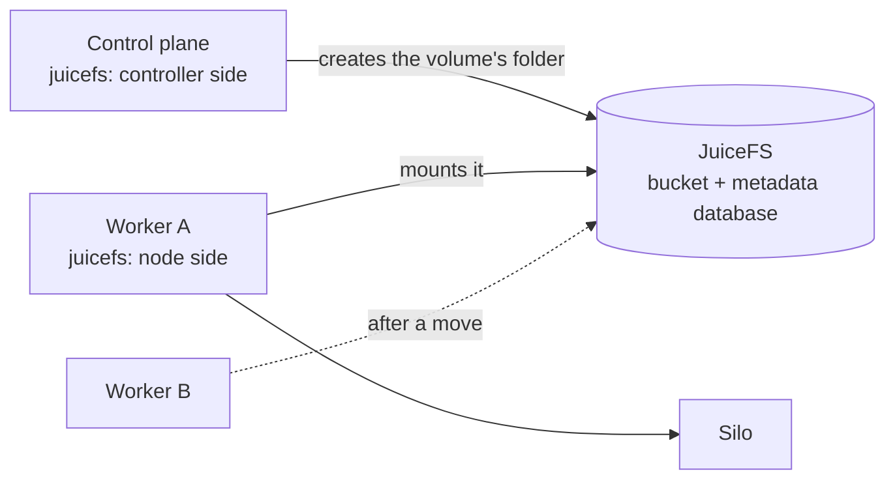

# JuiceFS

The JuiceFS provider gives silos **volumes that follow the silo to any host**:

| You write | You get |
|---|---|
| `volumes: [{ class: juicefs, … }]` | A folder in a shared file system, mounted into the silo wherever it runs |

JuiceFS keeps a volume's **data in a bucket** (any S3-compatible object store) and its **metadata in a database** (Postgres, Redis and others). A host that can reach
both can mount the volume, in any region, with no shared network and no cloud-specific disk. So a
silo whose volumes are all on a JuiceFS class can move to **any** host, and its `MOVABLE` column
says `Anywhere` ([Moves]({{ '/silos/moves/' | relative_url }})).



---

## Status: what works, what isn't confirmed

| | |
|---|---|
| **Container silos** (`docker`, `podman`) | Run on real cloud machines with `docker`: the volume formatted once, mounted with `--subdir` so the silo sees only its folder, sized, moved with its data, moved again after its host was powered off (running elsewhere with its data after about 1 m 20 s), and deleted. Not run with `podman`. |
| **MicroVM silos** (`cloud-hypervisor`) | In code and tested with fakes: a volume is shared into the VM over virtiofs, and a root disk can be an image file on a volume, so the VM moves ([Volumes]({{ '/silos/volumes/' | relative_url }})). **Not run on a real machine.** |
| **Volume sizes** | `size` is a directory quota on the volume's folder (whole GiB, rounded up): writes past it fail, and growing `size` in the spec raises it with the silo running. A volume with no `size` has no quota. |
| **The metadata database** | Bring your own. Kevaso doesn't run it for you yet. |
| **Silos that don't run as root** | Not handled: a volume's folder is owned by root with mode `0700`, so a program running as another user can't write to it. |
| **Volumes shared by several silos** | Not possible: the API has no such field. |
| **Removing the plugin while volumes use it** | Not refused. The data stays in the bucket and database, the node side's mounts keep serving the running silos, and the silo says `VolumesPending` until the plugin is back. Nothing unmounts those mounts later. |

---

## Before you start

- A bucket and its access key and secret key, from your object store.
- A metadata database every host can reach: say a Postgres on a private address. Its password goes in
  a file, never in the config.
- The `juicefs` program (version 1.4 or later) on the control plane and on every worker that will
  take silos with these volumes.
- Container workers (`--runtime docker` or `podman`).

**The metadata database is the part to look after.** Every host using the class talks to it all the
time. While it's down, reads and writes on the volumes **wait**, up to about 40 seconds, and carry
on by themselves if it comes back in that time. After that they fail with an I/O error until it's
back. The silo isn't marked failed: its `VolumesResponding` condition says `NotAnswering` while
calls wait and `Failing` once they fail. A silo whose program doesn't expect a stalled disk can look
frozen. Run the database somewhere that stays up, and back it up.

---

## The config

A JSON file naming the classes. It holds no secrets: credentials are only *named* in it.

```json
{
  "classes": [{
    "name": "juicefs",
    "metadata": "postgres://juicefs@10.63.0.1:5432/juicefs",
    "storage": "s3",
    "bucket": "https://objects.example.com/kevaso-volumes",
    "credentials": {
      "accessKey": "bucket-access-key",
      "secretKey": "bucket-secret-key",
      "metaPassword": "metadata-password"
    }
  }]
}
```

| Field | Meaning | Default |
|---|---|---|
| `name` | The storage class. Silos use it as `volumes[].class`. | required |
| `metadata` | The metadata database's URL, **without a password**. A URL with one is refused. | required |
| `bucket` | The bucket's URL | required |
| `storage` | The object store's type | `s3` |
| `fileSystem` | The JuiceFS file system's name | `kevaso` |
| `cacheDir`, `cacheSizeMiB` | The local cache on each host | `/var/cache/kevaso-juicefs/CLASS` |
| `credentials` | The *names* of the credentials holding the bucket's keys and the metadata password. Each is optional. | none |
| `description` | Text shown for the class | A standard line |
| `stateDir` | The controller side's folder, where it mounts each class's root | `/var/lib/kevaso-provider-juicefs` |
| `volumesDir` | The folder the node side mounts under | `/var/lib/kevaso/volumes` |

One file system per class, and one folder per volume in it. A silo is only given its own folder, so
it never sees another volume's files. The credentials reach `juicefs` through its environment,
never its command line, and **never reach the silo**: it only gets the mounted folder.

---

## Install it

Build the provider (for Linux):

```bash
git clone https://github.com/dlebee/kevaso-provider-juicefs
```

```bash
make -C kevaso-provider-juicefs build
```

Save the three secrets, each in a file only you can read:

```bash
chmod 600 ~/bucket-access-key.txt ~/bucket-secret-key.txt ~/metadata-password.txt
```

The **controller side** runs on the control plane. It formats the file system once, and creates and
deletes volumes' folders:

```bash
bin/kvoadm plugin install root@203.0.113.10 \
    --name juicefs \
    --binary kevaso-provider-juicefs/bin/kevaso-provider-juicefs-linux-amd64 \
    --manifest kevaso-provider-juicefs/kevaso-plugin.json --yes \
    --config juicefs.json \
    --credential bucket-access-key=$HOME/bucket-access-key.txt \
    --credential bucket-secret-key=$HOME/bucket-secret-key.txt \
    --credential metadata-password=$HOME/metadata-password.txt
```

The **node side** runs on each worker. It mounts a volume where the silo is placed, and unmounts it
when the silo leaves. It holds the same credentials:

```bash
bin/kvoadm plugin install root@203.0.113.20 \
    --name juicefs \
    --side node \
    --binary kevaso-provider-juicefs/bin/kevaso-provider-juicefs-linux-amd64 \
    --manifest kevaso-provider-juicefs/kevaso-plugin.json --yes \
    --config juicefs.json \
    --credential bucket-access-key=$HOME/bucket-access-key.txt \
    --credential bucket-secret-key=$HOME/bucket-secret-key.txt \
    --credential metadata-password=$HOME/metadata-password.txt
```

The names after `--credential` are the ones in the config's `credentials`. See
[Plugins]({{ '/extending/plugins/' | relative_url }}) for what `plugin install`
does with them. `--manifest` shows you what each side asks of the host (root, `/dev/fuse`, and on
the node side the host's own mount namespace) and `--yes` grants it: see [Plugins]({{ '/extending/plugins/' | relative_url }}#what-a-manifest-asks-for).

Kevaso only puts a silo with a JuiceFS volume on a host whose node side is running. A host reports
the classes it can mount in its status:

```bash
kvo get host hv2 -o yaml
```

Look for `mountClasses: [juicefs]` under `status`. (`kvo describe host` doesn't print it.)

---

## Use it

```yaml
apiVersion: kevaso/v1
kind: Silo
metadata: { name: db-1, namespace: payments }
spec:
  runtime: docker
  container:
    image: ghcr.io/example/db:5.2
  volumes:
    - { name: data, class: juicefs, size: 200Gi, mountPath: /data }
  availability: { onHostLoss: Move }
```

```bash
kvo get silos -n payments -o wide
```

```text
NAME   RUNTIME  PHASE    READY  HOST  MOVABLE   ON-CP-LOSS  AGE
db-1   docker   Running  yes    hv2   Anywhere  -           3m
```

`kvo move silo db-1 --to hv3` now works with the data: the old host stops the silo and unmounts the
volume, then the new host mounts it and starts it. Two hosts never have it mounted at once.

---

## Storage classes

| Class | Where it lives | Can the silo move? | From |
|---|---|---|---|
| `local` (the default) | On the silo's host | No: pinned to its host | Built in |
| A provider's block-storage class | A volume in one region | Another host in the same region | That provider's page |
| `juicefs` (any name you give it) | A bucket and a metadata database | Any host that runs the node side | This page |
