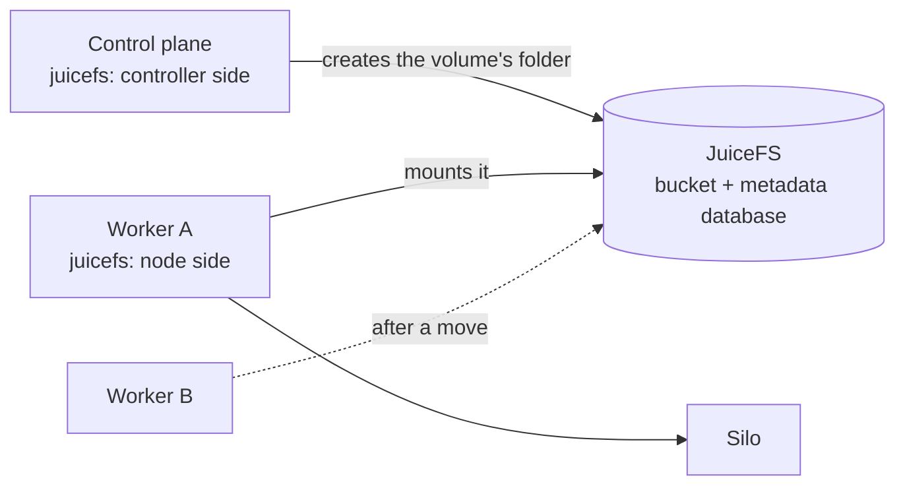

# JuiceFS

The JuiceFS provider gives silos **volumes that follow the silo to any host**:

| You write | You get |
|---|---|
| `volumes: [{ class: juicefs, … }]` | A folder in a shared file system, mounted into the silo wherever it runs |

JuiceFS keeps a volume's **data in a bucket** (anything S3-compatible: Cloudflare R2, Backblaze,
MinIO, AWS) and its **metadata in a database** (Postgres, Redis and others). A host that can reach
both can mount the volume, in any region, with no shared network and no cloud-specific disk. So a
silo whose volumes are all on a JuiceFS class can move to **any** host, and its `MOVABLE` column
says `Anywhere` ([Host loss and moves]({{ '/silos/moves/' | relative_url }})).



---

## Status: what works, what isn't confirmed

| | |
|---|---|
| **Container silos** (`docker`, `podman`) | Built and tested, with the JuiceFS command faked. |
| **On real machines** | **Not confirmed yet.** The node side needs root and `/dev/fuse`, and its mounts must be visible to Kevaso and the container runtime. The service that `kvoadm plugin install` writes today is locked down (no root, no devices, a read-only system), so it can't do that yet, nor does it give the node side the socket Kevaso looks for. Whether `juicefs mount --subdir` and `juicefs status` on a new database behave as the provider expects hasn't been tried on a real host either. |
| **MicroVM silos** (`cloud-hypervisor`) | Not supported: it needs a host folder shared into the VM (virtiofs), which isn't built. Use JuiceFS with container silos only. |
| **Disk-image mode** | Not built. |
| **Volume sizes** | `size` isn't enforced. |
| **The metadata database** | Bring your own. Kevaso doesn't run it for you yet. |

---

## Before you start

- A bucket and its access key and secret key, from your object store.
- A metadata database every host can reach: say a Postgres on a private address. Its password goes in
  a file, never in the config.
- The `juicefs` program (version 1.4 or later) on the control plane and on every worker that will
  take silos with these volumes.
- Container workers (`--runtime docker` or `podman`).

**The metadata database is the part to look after.** Every host using the class talks to it all the
time. While it's down, reads and writes on the volumes **hang** (they don't fail with an error), and
they carry on by themselves about two seconds after it's back. A silo whose program doesn't expect
a stalled disk can look frozen. Run the database somewhere that stays up, and back it up.

---

## The config

A JSON file naming the classes. It holds no secrets: credentials are only *named* in it.

```json
{
  "classes": [{
    "name": "juicefs",
    "metadata": "postgres://juicefs@10.63.0.1:5432/juicefs",
    "storage": "s3",
    "bucket": "https://ACCOUNT.r2.cloudflarestorage.com/acme-kevaso-volumes",
    "credentials": {
      "accessKey": "bucket-access-key",
      "secretKey": "bucket-secret-key",
      "metaPassword": "metadata-password"
    }
  }]
}
```

| Field | Meaning | Default |
|---|---|---|
| `name` | The storage class. Silos use it as `volumes[].class`. | required |
| `metadata` | The metadata database's URL, **without a password**. A URL with one is refused. | required |
| `bucket` | The bucket's URL | required |
| `storage` | The object store's type | `s3` |
| `fileSystem` | The JuiceFS file system's name | `kevaso` |
| `cacheDir`, `cacheSizeMiB` | The local cache on each host | `/var/cache/kevaso-juicefs/CLASS` |
| `credentials` | The *names* of the credentials holding the bucket's keys and the metadata password. Each is optional. | none |

One file system per class, and one folder per volume in it. A silo is only given its own folder, so
it never sees another volume's files. The credentials reach `juicefs` through its environment,
never its command line, and **never reach the silo**: it only gets the mounted folder.

---

## Install it

Build the provider (for Linux):

```bash
git clone https://github.com/dlebee/kevaso-provider-juicefs && make -C kevaso-provider-juicefs build
```

Save the three secrets, each in a file only you can read:

```bash
chmod 600 ~/bucket-access-key.txt ~/bucket-secret-key.txt ~/metadata-password.txt
```

The **controller side** runs on the control plane. It formats the file system once, and creates and
deletes volumes' folders:

```bash
bin/kvoadm plugin install root@203.0.113.10 \
    --name juicefs \
    --binary kevaso-provider-juicefs/bin/kevaso-provider-juicefs-linux-amd64 \
    --config juicefs.json \
    --credential bucket-access-key=$HOME/bucket-access-key.txt \
    --credential bucket-secret-key=$HOME/bucket-secret-key.txt \
    --credential metadata-password=$HOME/metadata-password.txt
```

The **node side** runs on each worker. It mounts a volume where the silo is placed, and unmounts it
when the silo leaves. It holds the same credentials:

```bash
bin/kvoadm plugin install root@203.0.113.20 \
    --name juicefs \
    --side node \
    --binary kevaso-provider-juicefs/bin/kevaso-provider-juicefs-linux-amd64 \
    --config juicefs.json \
    --credential bucket-access-key=$HOME/bucket-access-key.txt \
    --credential bucket-secret-key=$HOME/bucket-secret-key.txt \
    --credential metadata-password=$HOME/metadata-password.txt
```

The names after `--credential` are the ones in the config's `credentials`. See
[the Linode page]({{ '/providers/linode/' | relative_url }}#install-it) for what `plugin install`
does with them. **Remember the status table above: on a real host, the node side's service is the
part that isn't ready.**

Kevaso only puts a silo with a JuiceFS volume on a host whose node side is running. A host reports
the classes it can mount in its status:

```bash
kvo get host hv2 -o yaml
```

Look for `mountClasses: [juicefs]` under `status`. (`kvo describe host` doesn't print it yet.)

---

## Use it

```yaml
apiVersion: kevaso/v1
kind: Silo
metadata: { name: rpc-1, namespace: chain }
spec:
  runtime: docker
  image: ghcr.io/acme/node:5.2
  volumes:
    - { name: chain, class: juicefs, size: 200Gi, mountPath: /data }
  availability: { onHostLoss: Move }
```

```bash
kvo get silos -n chain -o wide
```

```text
NAME    RUNTIME  PHASE    HOST  MOVABLE   AGE
rpc-1   docker   Running  hv2   Anywhere  3m
```

`kvo move silo rpc-1 --to hv3` now works with the data: the old host stops the silo and unmounts the
volume, then the new host mounts it and starts it. Two hosts never have it mounted at once.

---

## Storage classes

| Class | Where it lives | Can the silo move? | From |
|---|---|---|---|
| `local` (the default) | On the silo's host | No: pinned to its host | Built in |
| `linode-block` | A Block Storage volume in one Linode region | Another Linode in the same region | [Linode]({{ '/providers/linode/' | relative_url }}) |
| `juicefs` (any name you give it) | A bucket and a metadata database | Any host that runs the node side | This page |
