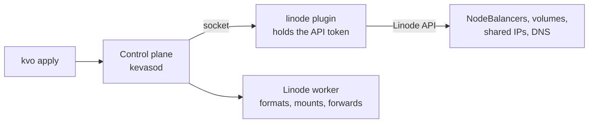

# Linode

The Linode provider lets silos on your Linode workers use what Linode offers:

| You write | You get |
|---|---|
| `loadBalancer: { class: linode-nodebalancer }` on a service | A NodeBalancer with its own IP, in front of the silo |
| `loadBalancer: { class: linode-shared-ip, ip: NAME }`, with an [`IP`]({{ '/networking/ips/' | relative_url }}) of that class | An IPv4 that follows the silo from one Linode to another |
| `volumes: [{ class: linode-block, … }]` | A Block Storage volume, kept when the silo restarts, deleted with it |
| `dns: { provider: linode }` on an IngressClass | Its host names published in Linode DNS |

It only narrows *where* those silos go: onto your Linodes, in the region their volume is in. The
rest of the cluster (a box at home, another provider) is unchanged.



Linode machines have no KVM, so their silos use a container runtime (`docker` or `podman`).

---

## Before you start

- A cluster with Linode workers added with `--runtime docker` ([Adding workers]({{ '/workers/' | relative_url }})).
- Each Linode worker has a **private IPv4** (Cloud Manager → the Linode → Network → Add an IP address
  → Private, then reboot it). NodeBalancers reach workers over it. Add the worker with its public
  address as `--external-ip`: the provider then makes the Linode's private address its internal IP
  (see [Addresses, ports and names]({{ '/networking/model/' | relative_url }})).
- A Linode **API token** (Cloud Manager → your profile → API Tokens → Create a Personal Access Token)
  with read/write on *Linodes*, *IPs* and *Volumes*, plus *NodeBalancers* and *Domains* if you use
  them. Without one of these, what needs it fails with Linode's `401`, shown on the silo or Ingress. Save it in a file
  only you can read:

```bash
chmod 600 ~/linode-token.txt
```

---

## Install it

Build the plugin (it runs on the Linodes, so it's built for Linux):

```bash
git clone https://github.com/dlebee/kevaso-provider-linode
```

```bash
make -C kevaso-provider-linode build
```

Store the token as a cluster secret. The binding below names service account `plugin-linode` in the namespace `kevaso-system`, the controller side's account. A host fetches the token only when that account may read it, so it reaches the control plane and never a worker: the node side's account, `plugin-linode-node`, is not bound to it.

```bash
kvo create clustersecret token --from-file ~/linode-token.txt
```

Save this as `linode-secrets.yaml`. `resourceNames` lists exactly this secret.

```yaml
apiVersion: kevaso/v1
kind: ClusterRole
metadata: { name: linode-secrets }
rules:
  - verbs: [get]
    resources: [clustersecrets/value]
    resourceNames: [token]
---
apiVersion: kevaso/v1
kind: ClusterRoleBinding
metadata: { name: linode-secrets }
roleRef: { kind: ClusterRole, name: linode-secrets }
subjects:
  - { kind: ServiceAccount, name: plugin-linode, namespace: kevaso-system }
```

```bash
kvo apply -f linode-secrets.yaml
```

On the control plane:

```bash
bin/kvoadm plugin install root@203.0.113.10 \
    --name linode \
    --binary kevaso-provider-linode/bin/kevaso-provider-linode-linux-amd64 \
    --cluster-secret token
```

```text
→ plugin linode, controller side:
    runs as its own dynamic user
    no capabilities
→ bind a ClusterRole to service account plugin-linode in namespace kevaso-system
→ connected to 203.0.113.10:22 (host key SHA256:kVvp5Yv9…)
→ kevaso-plugin-linode installed (signature verified on the host)
→ cluster secrets token recorded (kevasod writes each value, root only; the plugin reads it through systemd)
→ plugin linode recorded; kevasod writes its cluster secrets and starts kevaso-plugin-linode.service
```

Install creates the service account `plugin-linode` in the namespace `kevaso-system` and prints the account to bind. It records the name. It does not copy the file. The control plane fetches the token and keeps a copy only root can read. The plugin reads `token` from its credential directory. The value is never on a command line. Workers are not given the name, so they never receive the token. See [Plugins]({{ '/extending/plugins/' | relative_url }}).

To replace the token:

```bash
kvo set clustersecret token --from-file ~/linode-token.txt
```

The control plane writes the new copy and restarts the plugin. The same bytes again leave the plugin running.

Within a few seconds the Linode workers are recognised:

```bash
bin/kvoadm kvo describe host hv2
```

```text
Internal IP:  192.168.129.74 (the provider's private address)
External IP:  172.105.99.247
Region:       ca-central
Provider:     linode (#110903030 in ca-central, private 192.168.129.74)
…
```

---

## A NodeBalancer

```yaml
apiVersion: kevaso/v1
kind: Silo
metadata: { name: web, namespace: shop }
spec:
  runtime: docker
  container: { image: docker.io/library/nginx:1.27-alpine }
  resources: { cpu: 1, memory: 256Mi }
  ports:
    - { name: http, port: 80 }
  service:
    ports:
      - { port: http, loadBalancer: true }
    loadBalancer: { class: linode-nodebalancer }
```

```bash
bin/kvo describe silo web -n shop
```

```text
Load balancer:  linode-nodebalancer at 172.233.12.40
Node ports:     http 80 → host port 30000 (from 192.168.255.0/24)
```

The NodeBalancer sends each port to the silo's host on a **node port** over the private network.
The host forwards that port only from the NodeBalancer's addresses, so it isn't open to the
internet. If the silo is recreated on another Linode, the NodeBalancer follows it and keeps its IP.

The NodeBalancer belongs to an [`IP`]({{ '/networking/ips/' | relative_url }}). With none named, the namespace's shared one
for the class is used, so the namespace's services of this class share one NodeBalancer, each on its own
ports. Name another with `loadBalancer.ip`, or set `dedicated: true` for one of its own. The
NodeBalancer and its address last as long as the `IP`.

NodeBalancers here forward **TCP**. For UDP, use a shared IP. A NodeBalancer can't limit clients by
address, so a port with `sources` is left out of it: see
[leases and sources]({{ '/networking/leases/' | relative_url }}#load-balancers-from-a-plugin-and-sources).
You can tune one with annotations on the `IP` or the service: `linode.kevaso.com/algorithm`
(`roundrobin`, `leastconn` or `source`) and `linode.kevaso.com/proxy-protocol` (`none`, `v1` or `v2`).
Other annotations in that domain are refused.

**Outgoing traffic can't leave from the NodeBalancer's address.** It belongs to no Linode, so
`egress.source: sameAsService` is refused behind one (use `host`, or `pool` with an `ip-pool` address). See
[Can a silo use the same IP out as in?]({{ '/networking/' | relative_url }}#can-a-silo-use-the-same-ip-out-as-in).

A standalone Service can have one too (`type: LoadBalancer`, `loadBalancerClass:
linode-nodebalancer`): one NodeBalancer whose backends are every Linode with one of its endpoints,
on the Service's node ports (32000 and up). See [Sets, images and updates]({{ '/silos/sets/#an-outside-address' | relative_url }}).

---

## A volume

```yaml
spec:
  runtime: docker
  volumes:
    - { name: data, class: linode-block, size: 20Gi, mountPath: /var/lib/postgresql/data }
```

Kevaso creates the volume in the worker's region, attaches it, formats it **once** (only if it's
empty), and mounts it into the silo. From then on the silo stays in that region: the volume can't
leave it.

```text
Volumes:
  NAME  CLASS         SIZE  MOUNT                      WHERE              STATE
  data  linode-block  20Gi  /var/lib/postgresql/data   ca-central #19072311  mounted on hv2
```

Volumes are 10 GiB at least (Linode's minimum). **Deleting the silo deletes the volume**: Kevaso
waits for the host to unmount it, detaches it, then deletes it. A detach sometimes takes minutes on
Linode. Kevaso keeps asking and shows `detaching from hv2` meanwhile.

---

## A shared IP

A NodeBalancer's IP belongs to the NodeBalancer. A **shared IP** is an IPv4 that the provider shares
with the region's Linode workers. Whichever worker has the silo announces it (over BGP, like Linode's
lelastic), so when the silo moves, the address moves with it, in seconds. One silo holds it at a time.

It is an [`IP`]({{ '/networking/ips/' | relative_url }}) of class `linode-shared-ip`. Make one in your region, and Linode reserves an
IPv4 for it:

```bash
kvo create ip edge --class linode-shared-ip --region ca-central
```

Or adopt an IPv4 your account already has, with `spec.address`. Kevaso never gives that one back:

```yaml
apiVersion: kevaso/v1
kind: IP
metadata: { name: edge, namespace: shop }
spec: { class: linode-shared-ip, address: 172.105.3.63 }
```

Then the silo names it:

```yaml
spec:
  availability: { onHostLoss: Recreate }
  ports:
    - { name: web, port: 8080 }
  service:
    ports:
      - { port: web, loadBalancer: true }
    loadBalancer: { class: linode-shared-ip, ip: edge }
```

When the worker running it goes down, nothing moves by itself: once you know the Linode is off, `kvo move
silo NAME --to HOST --confirm-fenced --recreate` starts the silo on another worker and the address
answers from there ([When the control plane is lost]({{ '/silos/control-plane-loss/' | relative_url }})).
Add `onControlPlaneLoss: Stop` to the silo and Kevaso restarts it on another worker by itself only
after the old host reports that its copy stopped. A host that is down can't report, so then a person
moves the silo with `kvo move silo NAME -n NS --to HOST --confirm-fenced --recreate`.

**Outgoing traffic can leave from the shared IP too.** Set `network: { egress: { source: sameAsService } }`
on the silo, and its connections go out from the address people reach it on. See
[Can a silo use the same IP out as in?]({{ '/networking/' | relative_url }}#can-a-silo-use-the-same-ip-out-as-in).

The workers announce it with the plugin's node side. Install it on each Linode worker, giving its
region:

```bash
echo '{"region": "ca-central"}' > linode-node.json
```

```bash
bin/kvoadm plugin install root@172.105.99.247 \
    --name linode --side node \
    --binary kevaso-provider-linode/bin/kevaso-provider-linode-linux-amd64 \
    --config linode-node.json
```

The node side has no token and no privileges.

---

## DNS for your Ingresses

Add your domain in Cloud Manager (Domains), with Linode's name servers at your registrar. Then give
the IngressClass a DNS provider:

```yaml
apiVersion: kevaso/v1
kind: IngressClass
metadata: { name: public }
spec:
  controller: { driver: nginx, silo: ingress-public, namespace: kevaso-system }
  public: true
  hosts:
    - { host: "*.example.com", namespaces: [payments] }
  dns: { provider: linode }
```

Every host name of its Ingresses gets an A record pointing at the controller's address (its load
balancer's, else its host's external IP), and loses it when the Ingress goes. `ttl` sets the record's
time to live in seconds (300). Each record set carries a `_kevaso-owner` TXT record next to it. Kevaso
never changes a record it didn't create.

The same provider answers DNS-01 challenges, for wildcard certificates:

```yaml
apiVersion: kevaso/v1
kind: Issuer
metadata: { name: letsencrypt }
spec:
  acme:
    server: https://acme-v02.api.letsencrypt.org/directory
    email: you@example.com
    solvers:
      - dns01: { provider: linode, propagationSeconds: 120 }
```

---

## Other storage

A silo can mix classes, and the narrowest one decides where it can go. The classes are listed on
[JuiceFS]({{ '/providers/juicefs/#storage-classes' | relative_url }}).

---

## Removing it

```bash
bin/kvoadm plugin remove root@203.0.113.10 --name linode
```

This removes the unit on that host, and the program, the copy of the token and the service account once no side is left there. The cluster secret and the role stay until you delete them:

```bash
kvo delete clustersecret token
```

Delete the silos using its classes first. Their NodeBalancers and volumes are deleted with them, and nothing deletes them once the plugin is gone.
