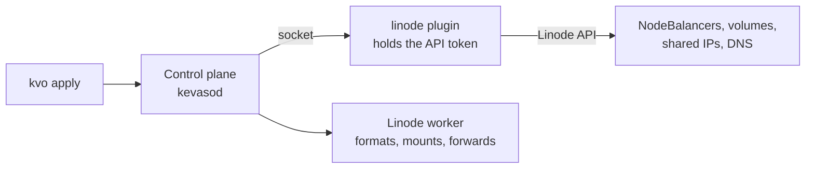

# Linode

The Linode provider lets silos on your Linode workers use what Linode offers:

| You write | You get |
|---|---|
| `loadBalancer: { class: linode-nodebalancer }` | A NodeBalancer with its own public IP, in front of the silo |
| `loadBalancer: { class: linode-shared-ip, address: … }` | An IPv4 you own that follows the silo from one Linode to another |
| `volumes: [{ class: linode-block, … }]` | A Block Storage volume, kept when the silo restarts, deleted with it |
| `dns: { provider: linode }` on an IngressClass | Its host names published in Linode DNS |

It only narrows *where* those silos go: onto your Linodes, in the region their volume is in. The
rest of the cluster (a box at home, another provider) is unchanged.



Linode machines have no KVM, so their silos use a container runtime (`docker` or `podman`).

---

## Before you start

- A cluster with Linode workers added with `--runtime docker` ([Adding workers]({{ '/workers/' | relative_url }})).
- Each Linode worker has a **private IPv4** (Cloud Manager → the Linode → Network → Add an IP address
  → Private, then reboot it). NodeBalancers reach workers over it.
- A Linode **API token** (Cloud Manager → your profile → API Tokens → Create a Personal Access Token)
  with read/write on *Linodes*, *IPs* and *Volumes*, plus *NodeBalancers* and *Domains* if you use
  them. Without one of these, what needs it fails with Linode's `401`, shown on the silo or Ingress. Save it in a file
  only you can read:

```bash
chmod 600 ~/linode-token.txt
```

---

## Install it

Build the plugin (it runs on the Linodes, so it's built for Linux):

```bash
git clone https://github.com/dlebee/kevaso-provider-linode && make -C kevaso-provider-linode build
```

On the control plane, with the token:

```bash
bin/kvoadm plugin install root@203.0.113.10 \
    --name linode \
    --binary kevaso-provider-linode/bin/kevaso-provider-linode-linux-amd64 \
    --credential token=$HOME/linode-token.txt
```

```
→ connected to 203.0.113.10:22 (host key SHA256:kVvp5Yv9…)
→ kevaso-plugin-linode installed (signature verified on the host)
→ credential token stored on the host (root only; the plugin reads it through systemd)
→ plugin linode running (kevaso-plugin-linode.service); kevasod registers it from /run/kevaso-plugins/linode/plugin.sock
```

The token is read from the file and sent over SSH; it's never on a command line on the host. It
stays on the control plane, readable only by root and by the plugin's own unit. kevasod and the
workers never see it.

Within a few seconds the Linode workers are recognised:

```bash
bin/kvo describe host hv2
```

```
Address:     172.105.99.247
Region:      ca-central
Provider:    linode (#110903030 in ca-central, private 192.168.129.74)
…
```

---

## A NodeBalancer

```yaml
apiVersion: kevaso/v1
kind: Silo
metadata: { name: web, namespace: shop }
spec:
  runtime: docker
  image: docker.io/library/nginx:1.27-alpine
  resources: { cpu: 1, memory: 256Mi }
  service:
    ports: [{ name: http, port: 80 }]
    expose: loadBalancer
    loadBalancer: { class: linode-nodebalancer }
```

```bash
bin/kvo describe silo web -n shop
```

```
Exposure:    loadBalancer (linode-nodebalancer)
Public IP:   172.233.12.40
Node ports:  http 80 → host port 30000 (from 192.168.255.0/24)
```

The NodeBalancer sends each port to the silo's host on a **node port** over the private network.
The host forwards that port only from the NodeBalancer's addresses, so it isn't open to the
internet. If the silo is recreated on another Linode, the NodeBalancer follows it and keeps its IP.

NodeBalancers here forward **TCP**. For UDP, use a shared IP.

---

## A volume

```yaml
spec:
  runtime: docker
  volumes:
    - { name: data, class: linode-block, size: 20Gi, mountPath: /var/lib/postgresql/data }
```

Kevaso creates the volume in the worker's region, attaches it, formats it **once** (only if it's
empty), and mounts it into the silo. From then on the silo stays in that region: the volume can't
leave it.

```
Volumes:
  NAME  CLASS         SIZE  MOUNT                      WHERE              STATE
  data  linode-block  20Gi  /var/lib/postgresql/data   ca-central #19072311  mounted on hv2
```

Volumes are 10 GiB at least (Linode's minimum). **Deleting the silo deletes the volume**: Kevaso
waits for the host to unmount it, detaches it, then deletes it. A detach sometimes takes minutes on
Linode. Kevaso keeps asking and shows `detaching from hv2` meanwhile.

---

## A shared IP

A NodeBalancer's IP belongs to the NodeBalancer. A **shared IP** belongs to you: an IPv4 of one of
your Linodes that the provider shares with the region's Linode workers. Whichever worker has the
silo announces it (over BGP, like Linode's lelastic), so when the silo moves, the address moves with
it, in seconds.

Linode gives each Linode one IPv4. An **extra** one for this comes through a support ticket. Then:

```yaml
spec:
  availability: { onHostLoss: Recreate }
  service:
    ports: [{ name: p2p, port: 30303, protocol: UDP }]
    expose: loadBalancer
    loadBalancer: { class: linode-shared-ip, address: 172.105.3.63 }
```

When the worker running it goes down, the silo is recreated on another Linode worker, and the
address answers from there. In our test that took 1m13s, nearly all of it the time Kevaso waits
before deciding a host is lost and recreating its silo. The address itself moves in seconds.

The workers announce it with the plugin's node side. Install it on each Linode worker, giving its
region:

```bash
echo '{"region": "ca-central"}' > linode-node.json
```

```bash
bin/kvoadm plugin install root@172.105.99.247 \
    --name linode --side node \
    --binary kevaso-provider-linode/bin/kevaso-provider-linode-linux-amd64 \
    --config linode-node.json
```

The node side has no token and no privileges.

---

## DNS for your Ingresses

Add your domain in Cloud Manager (Domains), with Linode's name servers at your registrar. Then give
the IngressClass a DNS provider:

```yaml
apiVersion: kevaso/v1
kind: IngressClass
metadata: { name: public }
spec:
  controller: { silo: ingress, namespace: kevaso-system }
  public: true
  dns: { provider: linode }
```

Every host name of its Ingresses gets an A record pointing at the controller's public IP, and loses
it when the Ingress goes. Each record set carries a `_kevaso-owner` TXT record next to it. Kevaso
never changes a record it didn't create.

The same provider answers DNS-01 challenges, for wildcard certificates:

```yaml
apiVersion: kevaso/v1
kind: Issuer
metadata: { name: letsencrypt }
spec:
  acme:
    server: https://acme-v02.api.letsencrypt.org/directory
    email: you@example.com
    solvers:
      - dns01: { provider: linode, propagationSeconds: 120 }
```

---

## Removing it

```bash
bin/kvoadm plugin remove root@203.0.113.10 --name linode
```

This removes the unit, the program and the stored token. Delete the silos using its classes first.
Their NodeBalancers and volumes are deleted with them, and nothing deletes them once the plugin is
gone.
