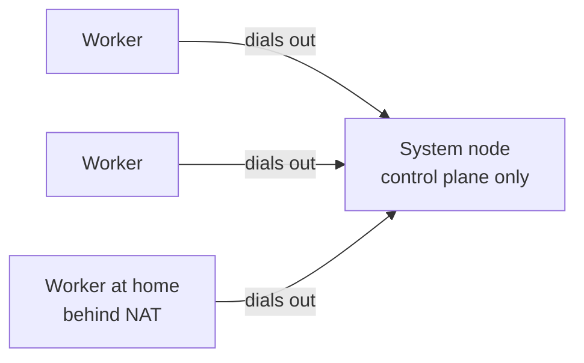

# Choosing a setup

Every Kevaso cluster has a **system node** (the control plane) and any number of
**workers** (the silos). How you arrange them decides what survives when a machine fails, and what
an attacker gets if one is broken into. This page compares the options; the pages after it set each
one up.

---

## The options

| Setup | Machines | Recommended for |
|---|---|---|
| [Running locally](#running-locally) | A VM on your computer | Trying Kevaso, developing it |
| [Dedicated system node + workers](#dedicated-system-node--workers) | 1 + N | **Most clusters.** The default choice. |
| [Combined node](#combined-node-control-plane-and-silos-on-one-machine) | 1 (both roles) | One machine, run by someone who knows the trade-offs |
| [Several system nodes](#several-system-nodes) | 3, or 2 and a small one | A control plane that survives losing a machine |

---

## What a system node is responsible for

To understand what fails when it does, here is what lives on a system node:

| Piece | If the system node is down |
|---|---|
| The API (everything `kvo` and `kvoadm` do) | No changes: no new silos, no `apply`, no `exec` |
| The store (every object) and the cluster CA | Safe on its disk; back once it's up |
| The scheduler and controllers | Nothing new is placed; lost hosts aren't handled |
| The sign-in provider | Nobody can sign in or refresh a token |
| The secrets' master key, and the broker's decisions | Silos can't fetch secrets (`kvo-guest secret get` fails) |

And what keeps working on the workers without it:

| Silo | Without the system node |
|---|---|
| `onHostLoss: Wait` (the default) | **Keeps running.** Its host keeps it up and restarts it if it dies. |
| `onHostLoss: Recreate` | **Stopped after 30 seconds** by its own host, on purpose: the system node may be recreating it elsewhere, and two copies must never run. |
| Injected keys (Kevaso's egress gate) | Keep working for about a minute (cached), then the gate stops adding them |
| Injected keys on OpenShell silos | Keep working: OpenShell holds them |

---

## Running locally

The control plane and a worker in a Linux VM on your own computer (Lima on a Mac). Nothing about it
is special: it's the same `kvoadm` steps, against a VM.

| | |
|---|---|
| **Fault tolerance** | None. Your laptop sleeps, the cluster sleeps. |
| **Operational risk** | Low: it's yours and it's disposable. Don't keep secrets you care about in it. |
| **Good for** | Learning Kevaso, the [quick start]({{ '/quickstart/' | relative_url }}), developing it |

→ [Running locally]({{ '/setup/local/' | relative_url }})

---

## Dedicated system node + workers

One machine runs only the control plane; silos run on other machines. **This is the recommended
setup.**

| | |
|---|---|
| **Fault tolerance** | Losing a **worker**: its `Wait` silos wait, its `Recreate` silos start elsewhere after 30 s. Losing the **system node**: running `Wait` silos keep running, but nothing changes until it's back (see the tables above); [several system nodes](#several-system-nodes) remove that. |
| **Recovery** | Bring the machine back, and everything resumes. |
| **Operational risk** | The system node is a single point of control: keep it small, patched, and running nothing else. |
| **Security** | A silo broken out of its VM lands on a *worker*, which only ever gets the secrets of its own silos, and can't act as another host. |
| **Cost** | The system node can be small: 1–2 CPUs, 2 GiB. |

→ [Single system node]({{ '/setup/single-node/' | relative_url }}), then [adding workers]({{ '/workers/' | relative_url }})

---

## Combined node (control plane and silos on one machine)

One machine is both the system node and a worker. Fully supported, and the simplest thing that
works — but **not the first recommendation**. If you understand the trade-offs below and accept
them, it's a perfectly good way to run a small cluster.

| | |
|---|---|
| **Fault tolerance** | None: that machine *is* the cluster. When it's down, everything is down. |
| **Operational risk** | Silos compete with the control plane for CPU, memory and disk. A silo that fills the disk or eats the memory can slow or stop the API. Rebooting for a kernel update stops all silos and the API together. |
| **Security risk** | The biggest one. A silo that escapes its VM or container lands on the machine that holds the cluster CA, the store and the **master key for every secret**. Root on a system node is trusted with everything; on a combined node, a silo is one escape away from it. Prefer it for silos you trust (your own dev boxes), not for untrusted code or agents running other people's input. |
| **Grows into** | The recommended setup: add workers, then move silos off. |

→ [Single system node]({{ '/setup/single-node/' | relative_url }}#step-2--let-the-machine-run-silos-optional)

---

## Several system nodes

Three system nodes (or two, and a small **light node** that only votes) keep the control plane up
when one machine is lost: the API answers, silos are scheduled, `kvo exec` works. Start on the
embedded etcd store (`kvoadm init … --store etcd`), or switch later with `kvoadm store migrate`,
then add the others with `kvoadm host add … --install control-plane`.

| | |
|---|---|
| **Fault tolerance** | Lose one system node: nothing stops. Lose two of three: the store stops taking changes until one is back; silos keep running |
| **Operational risk** | More machines to patch, and port 2380 open between them. `kvoadm upgrade` rolls them one at a time |
| **Proven** | On real Linodes: three system nodes, two with a light node, losing and removing one, an upgrade |

→ [High availability]({{ '/operations/ha/' | relative_url }})
