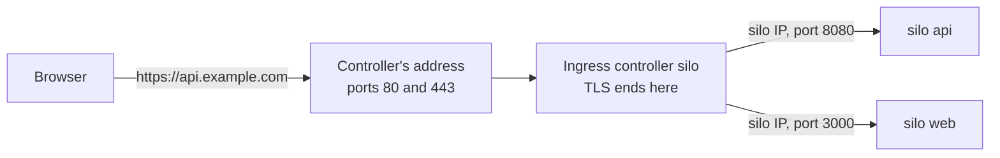

# HTTPS sites (ingress)

One address, ports 80 and 443, many sites. An **ingress controller** reads HTTP, ends TLS, and sends
each request to the right service by host name and path. The silos themselves stay private.



Compare with a [`hostPort`]({{ '/use/networking/' | relative_url }}#on-the-hosts-address-hostport): that forwards raw
TCP or UDP to **one** silo; an ingress reads HTTP and routes to **many**.

---

## The pieces

| Object | What it is |
|---|---|
| **Ingress controller** | An ordinary silo running a stock proxy as its vendor ships it, with its ports 80 and 443 open on its host or a load balancer |
| **IngressClass** | Which silo serves a class of Ingresses, with which proxy driver, whether the class is public, and which host names each namespace may publish |
| **Ingress** | Host names and paths → a service's port, and where its certificate comes from |
| **Issuer** | Where certificates come from: an ACME server (Let's Encrypt) or the cluster's own CA |
| **Certificate** | Made for each Ingress with TLS; issued into a Secret and renewed by Kevaso |

The proxy is stock: Kevaso adds no program, token, socket or certificate authority to its silo, and the
proxy never calls Kevaso. A **driver** turns the class's routes, certificates and ACME challenges into
the proxy's own configuration. The host of the controller's silo writes it into the silo, checks it
with the proxy's own test, and reloads the proxy.

---

## Before you start: what an admin sets up

An Ingress needs three things an administrator makes first, once per cluster or per name. Ask
for them, or see [Ingress controllers and certificates]({{ '/admin/ingress/' | relative_url }}) if
you are the admin:

- **A controller and its class.** `kvo get ingressclasses` lists the classes there are.
- **Your host name assigned to your namespace** on that class. Without it, your Ingress is refused
  (below).
- **On a public class, the permission to publish:** `create` on `ingresses/publish-public` in the
  namespace. Namespace `admin`s have it, `editor`s don't, so nobody puts something on the internet
  by accident. An `editor` writes the Ingress and an admin applies it, or the class is private.

Where certificates come from is each Ingress's choice (`tls.issuer`, [below](#routes)), among the
Issuers the admin made. Two exist from the start: `letsencrypt` and `internal-ca`.

## 1 · A site

The app. It declares its port, and its service opens that port. With no `allowFrom` and no `hostPort`,
nothing reaches it except what an Ingress adds:

```yaml
apiVersion: kevaso/v1
kind: Silo
metadata: { name: api, namespace: payments }
spec:
  runtime: docker
  container:
    image: docker.io/library/python:3.12-slim
    command: [python3, -m, http.server, "8080"]
  ports:
    - { name: http, port: 8080 }
  service:
    ports: [{ port: http }]
```

And its Ingress, which names the **service** and one of its ports:

```yaml
apiVersion: kevaso/v1
kind: Ingress
metadata: { name: api, namespace: payments }
spec:
  ingressClass: public
  hosts: [api.example.com]
  rules:
    - { path: /, service: { name: api, port: http } }
```

```bash
kvo apply -f api.yaml
```

The class must already assign `api.example.com` to `payments`. Otherwise the API refuses the Ingress
with status 422:

```text
host "api.example.com" is not assigned to namespace payments on ingress class public: set IngressClass.spec.hosts, or add one with: kvoadm ingress assign public --host api.example.com=payments
```

The fix is the admin's: [assign the name]({{ '/admin/ingress/#2--the-class' | relative_url }}).

The Ingress opens exactly one path through the firewall: from the class's controller to the silo's
`http` port. Nothing else can reach it. The service can be a silo's own (its `service.name`, or the
silo's name) or a standalone `Service`, which sends to every silo it selects. A `LoadBalancer`
Service publishes outside only ports those silos already open, and not a port that opens only on
a lease: a silo that doesn't is left out of it. If the silo is held
back by [`routeWhen`]({{ '/use/silos/probes/' | relative_url }}), or isn't running, its route is left out until it is
routed again.

## 2 · DNS

Point the host name at the controller's address. `kvo` shows it:

```bash
kvo get ingresses -n payments
```

```text
NAME   CLASS    HOSTS             ADDRESS        READY
api    public   api.example.com   203.0.113.10   no (CertificatePending)
```

The address is the controller's load-balancer address, else its host's external IP, else its internal
IP. Make an `A` record `api.example.com → 203.0.113.10` at your DNS provider, or set `dns` on the class
and a provider plugin does it.

## 3 · The certificate

As soon as the name points at the controller, Kevaso gets a certificate from Let's Encrypt (HTTP-01:
Let's Encrypt fetches a token from the controller on port 80), stores it in a Secret, and the
controller serves it:

```bash
kvo get certificates -n payments
```

```text
NAME      HOSTS             ISSUER        EXPIRES      READY
api-tls   api.example.com   letsencrypt   2027-02-10   yes
```

It's renewed by itself at two thirds of its life (after 60 of Let's Encrypt's 90 days). A failed
attempt waits a minute, then doubles up to an hour, so a broken setup doesn't hammer the CA.
`kvo describe certificate api-tls -n payments` shows its dates and, if something's wrong, why.

Now `https://api.example.com` reaches the silo. `http://` is redirected to it with a `308`, and a
request for a host no Ingress names gets a `404` (`nginx` and `caddy`).

---

## Routes

| Field | Means |
|---|---|
| `ingressClass` | The class that serves it (required) |
| `hosts` | The names this Ingress answers for |
| `rules[].path` | A path prefix, starting with `/`; the longest matching one wins (`/admin` before `/`). Default `/` |
| `rules[].service` | `{ name, port }`: a service's name and one of its ports, by name |
| `tls.issuer` | The Issuer its certificate comes from. Without one: the cluster's default for the class, `letsencrypt` on public classes and `internal-ca` on private ones (`kevasod control-plane --default-issuer-public` / `--default-issuer-private`) |
| `tls.secretName` | A certificate you keep yourself, in that Secret (chain and key, PEM): no certificate is made |
| `tls.none` | `true`: plain HTTP, on private classes only |

At most one of the three `tls` fields. Two Ingresses that claim the same host and path: the first by
name keeps it, and the other's route is left out.

The app sees the original `Host`. `nginx` and `caddy` pass the client's address in `X-Real-IP`, and `nginx` also in `X-Forwarded-For`.

---

## When the proxy refuses a configuration

A new configuration is checked inside the silo, with the proxy's own test, **before** the running proxy
sees it. **One broken Ingress holds back only itself.** An Ingress that its driver refuses (an
annotation it doesn't know, a bad value, a host name or path it can't take), that won't render, or
that makes the proxy's test fail is left out with the reason. Every other Ingress of the class, new
ones included, is applied, and the class keeps issuing and renewing certificates. An Ingress that was
already being served keeps being served in its last good version; only the change is held back.

| Where | What it shows |
|---|---|
| `kvo get ingressclass NAME -o yaml` | `status.controllers[]`, one per controller silo: `applied` (the configuration in effect), `rejected` (one segment per Ingress that is left out: `ingress NAMESPACE/NAME: why; ingress …`), `blamed` (those Ingresses). The condition `Applied` is false with the reason `Rejected` while any Ingress is left out, although the rest is served |
| `kvo get ingresses` | The Ingress that caused it has `READY` false. `Rejected`: the proxy blamed it. `Refused`: its driver refuses an annotation or a value before it gets that far |
| `kvo describe ingress NAME` | Its conditions, with the reason and message |

Other reasons an Ingress isn't ready: `NoClass` (the class doesn't exist), `NoDriver` (the class names
a driver this cluster doesn't have) and `CertificatePending`.

Values are checked before they reach the configuration: nothing is quoted or escaped for you.

An Ingress the proxy refused is left out and tried again on a backoff, with no change required.
The first try is 30 seconds later. Each refusal after that doubles the wait, up to 10 minutes, and
it stays at 10 minutes while the proxy still refuses. Once the proxy accepts it, it is served and
the status clears. The other Ingresses of the class keep being served the whole time. Applying a
fix is checked on the next pass, without waiting out the backoff.

### How the broken one is found

When the proxy refuses the whole configuration, Kevaso looks for the Ingress at fault:

1. It takes the proxy's own blame, when the proxy names one.
2. Otherwise it tests the Ingresses changed since the last good configuration, each on its own and by
   halving, on the side (the proxy's test is run on files that are not the running ones). It spends at
   most **12** test runs per change.
3. An Ingress the 12 runs did not reach is `not checked yet: finding the Ingress the proxy refuses
   took more than 12 test runs`: it is not served, and tried again on the next pass.

Kong has no test on the side: applying the previous state plus some changes is its test, which never
drops a route that was working. An unchanged state costs no test run until the backoff above is due.
A refused Ingress is tried again on that backoff even when it and the class's options are unchanged.

### When the whole class is held

A class is **held** only when the proxy refuses even the configuration with none of your Ingresses
in it: the class's own part, its options or its challenges. (This is not the same as a silo held back
by `routeWhen`.) Nothing new is applied and the last good configuration keeps being served. The class
shows `rejected` as `held (the last good configuration stays): the proxy refuses even the class's own
part: …`. Fixing the class's options releases it.

| While left out or held | |
|---|---|
| Still served | The last good routes and certificates, new valid Ingresses (not while the whole class is held), and **ACME HTTP-01 challenges**, so one tenant's bad annotation does not stop certificates being issued or renewed |
| Not served | The broken Ingress's change (its last good version stays), a changed class option while held |

The controller silo keeps a record of what the proxy accepted. An agent restart reads that record
and checks it against what the proxy is running. A restart changes no route. A missing, truncated
or corrupted record does not by itself change what the proxy serves: the proxy is read first, and
a class is held rather than dropping a route that may still be there.

---

## Not built

Not built: drivers from plugins, request limits and authentication in front of a route, TCP and UDP
routes, HTTP/3, and a proxy managing its own certificates.

---

## Wildcards

A wildcard needs DNS-01. Ask for it with a Certificate of its own:

```yaml
apiVersion: kevaso/v1
kind: Certificate
metadata: { name: internal-wildcard, namespace: payments }
spec:
  hosts: ["*.internal.example.com"]
  issuer: letsencrypt-dns     # an Issuer with a dns01 solver, made by an admin
  secretName: internal-wildcard-tls
```

The class has to assign that suffix to the namespace first (`hosts: [{ host: "*.internal.example.com", namespaces: [payments] }]`, which an [admin does]({{ '/admin/ingress/#2--the-class' | relative_url }})). The certificate and its key land in the Secret `internal-wildcard-tls`, renewed like any other.

