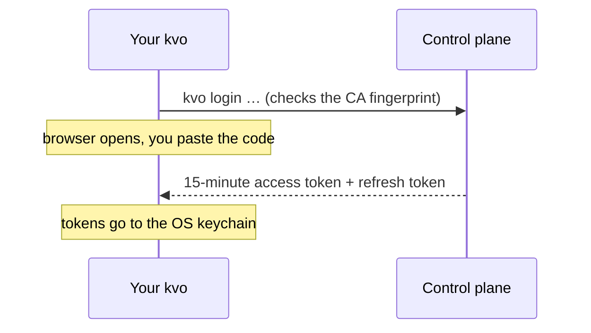

# Signing in and contexts

You have `kvo` ([Install kvo]({{ '/use/install/' | relative_url }})), and an admin invited you to a
namespace and sent you two things: a `kvo login …` line and a one-time invite code. This page signs
you in, sets your default namespace, and shows how to ask what you may do.

---

## How sign-in works

There is no username or password. You sign in once, in your browser, with the **one-time invite
code** an admin gave you. After that your session renews itself while you use `kvo`, and ends after
30 days without use; then you need a new invite.

Underneath, the control plane is its own sign-in provider (OpenID Connect), and `kvo` holds
short-lived tokens that refresh themselves:



| | Lives | Where |
|---|---|---|
| Invite code | 15 minutes, used once | Sent to you by the admin |
| Access token | 15 minutes | Memory, sent with each request |
| Refresh token | Rotates on every use. Idle limit 30 days | macOS Keychain (or a 0600 file on Linux) |

A refresh token is used once. Two `kvo` commands that refresh at the same moment can both present
the token that was just replaced. Within **60 seconds** that is a race: the session stays, and the
answer is `refresh raced with another; try again`. The client reads its token again. After 60
seconds the same token ends the session for everyone: `refresh token was already used; session
revoked`. Sign in again.

An invite code that ran out is not renewed, and neither is a session that ended: ask the admin for
a new invite ([Invite someone]({{ '/admin/access/#invite-someone' | relative_url }})).

---

## Sign in

Run the line the admin sent you. It looks like this:

```bash
kvo login https://203.0.113.10:6443 --ca sha256:4b1d…
```

Your browser opens a "Sign in to Kevaso" page; paste the code. The `--ca` fingerprint is how your
`kvo` knows it's talking to the right cluster: it refuses any other certificate, so there is no
warning to click through.

`kvo login` accepts only `https://` servers. An invite with several control planes prints them
comma-separated. `kvo login` tries each one for the CA and keeps the whole list in the context.

```bash
kvo auth whoami
```

```bash
kvo ns payments
```

`kvo ns` sets your default namespace. You can now `apply`, `get` and `exec` in the namespaces your
role covers, and you see no other namespace.

---

## What you may do

What you may do is your role in each namespace. The built-in ones:

| Role | Can |
|---|---|
| `viewer` | Read silos, sets, services, images, ingresses, certificates, grants; see that secrets exist |
| `editor` | All of that, plus create and change them, `exec`, terminals and files, plain moves, opening leased ports; create and *use* secrets (never read a value back) |
| `admin` | All of that, plus roles and bindings, service-account tokens, opening ports to the outside, publishing on a public ingress class, keeping IPs, reading secret values, answering approvals |

The full list of permissions, and how an admin gives them, is on
[People and access]({{ '/admin/access/#roles' | relative_url }}). Ask the cluster what you may do:

```bash
kvo auth can-i create silos/exec -n payments
```

It exits 0 for yes and 1 for no, so it fits in scripts. `ssh`, `files`, `open`, `close` and `move`
are read as silo subresources, so `silos/ssh` is the terminal on a silo and not a silo named `ssh`.

A refusal names what is missing, such as `no role lets bob get namespaces/demo`. Ask an admin for
that permission, or to do that step for you.

### What an admin does for you first

Some things are never an `editor`'s. When a page needs one of them, it says so:

| You need | Who | Where |
|---|---|---|
| A namespace | Cluster admin | [Your own kvo, and the admin certificate]({{ '/admin/access/#your-own-kvo-and-the-admin-certificate' | relative_url }}) |
| A role or a binding (more than `editor`, a CI account's role) | Namespace admin | [Roles]({{ '/admin/access/#roles' | relative_url }}) |
| A token for CI | Namespace admin | [Tokens for CI]({{ '/admin/access/#tokens-for-ci' | relative_url }}) |
| A port open on a host address or a load balancer | Namespace admin | [Networking]({{ '/use/networking/#on-the-hosts-address-hostport' | relative_url }}) |
| An address you keep (an IP) | Namespace admin | [Addresses you keep]({{ '/admin/ips/' | relative_url }}) |
| A host name on an ingress class, or a public class | Cluster admin | [Ingress controllers and certificates]({{ '/admin/ingress/' | relative_url }}) |
| A secret's value read back, or an approval answered | Namespace admin | [Secrets]({{ '/use/secrets/#who-can-do-what-with-secrets' | relative_url }}) |
| A move that says the old host is off (`--confirm-fenced`) | Cluster admin | [When the control plane is lost]({{ '/admin/control-plane-loss/#moving-a-silo-off-a-host-you-know-is-off' | relative_url }}) |

---

## Contexts

Like kubeconfig contexts: one per cluster you use.

```bash
kvo ctx
```

```bash
kvo ctx home
```

The file is `~/.kevaso/config.yaml` (or `$KVO_CONFIG`). It holds addresses, CA fingerprints and
certificate paths, never tokens. A cluster with more than one system node lists them in a
context's `server`, comma-separated: `kvo` sticks to the last one that answered and moves on only
when it can't connect.

### A certificate context

A context can sign in with a client certificate instead of a token: the one `kvoadm init` writes
for the person who set up the cluster is one. The certificate lasts 30 days. `kvo` renews it by
itself at two thirds of that life, or inside the last ten days if that comes sooner, and stores the
new certificate as the same person. You do nothing while it can still connect.

Inside the last ten days, a renewal that fails is a warning and the current certificate is still
used. Once it has expired, `kvo` stops and names the `kvoadm` command that signs a new one. That
runs over SSH, so an administrator runs it
([Your own kvo, and the admin certificate]({{ '/admin/access/#your-own-kvo-and-the-admin-certificate' | relative_url }})).

---

## In CI

A script or a pipeline signs in as a **service account** with a token: set `KVO_TOKEN` to the token
and `KVO_CA_FILE` to the cluster CA. A namespace admin makes the account, gives it a role and mints
the token ([Tokens for CI]({{ '/admin/access/#tokens-for-ci' | relative_url }})). An `editor`
cannot mint one: a token holds whatever its account holds.
